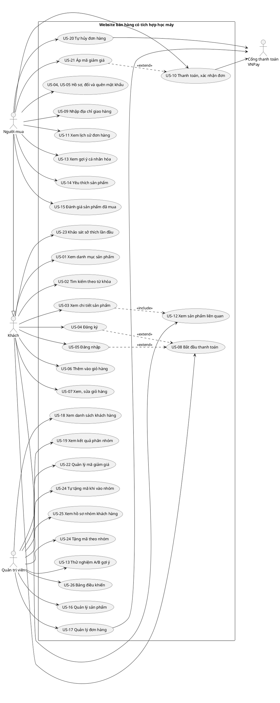
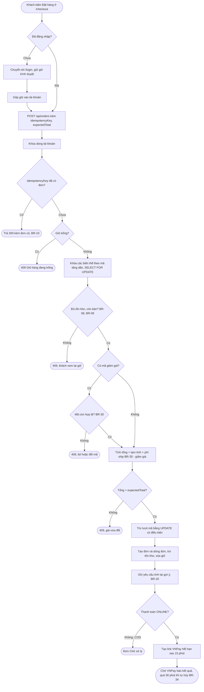
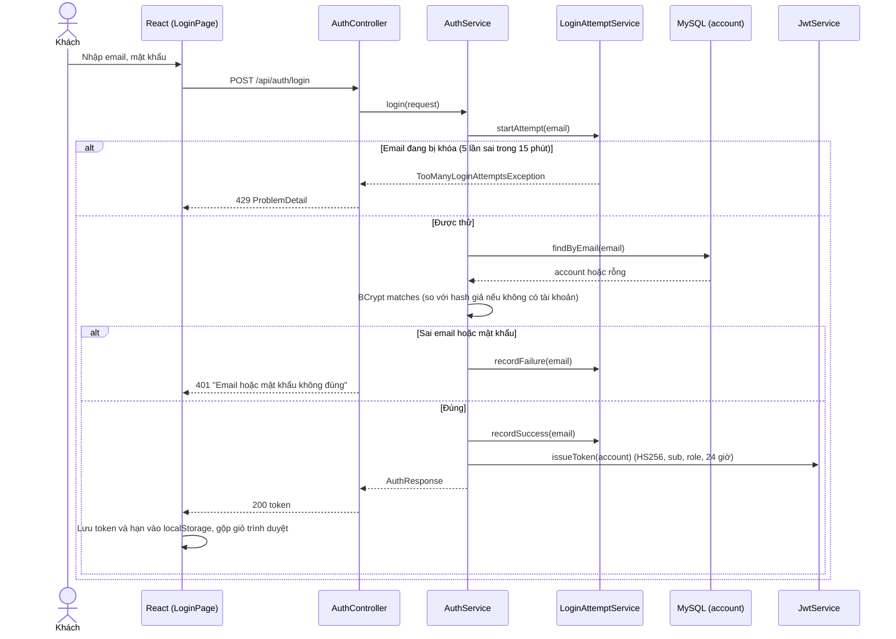
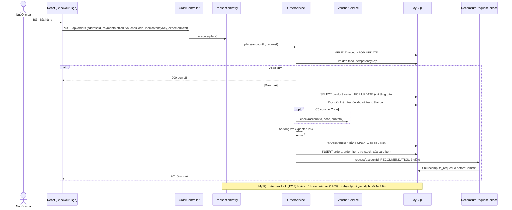
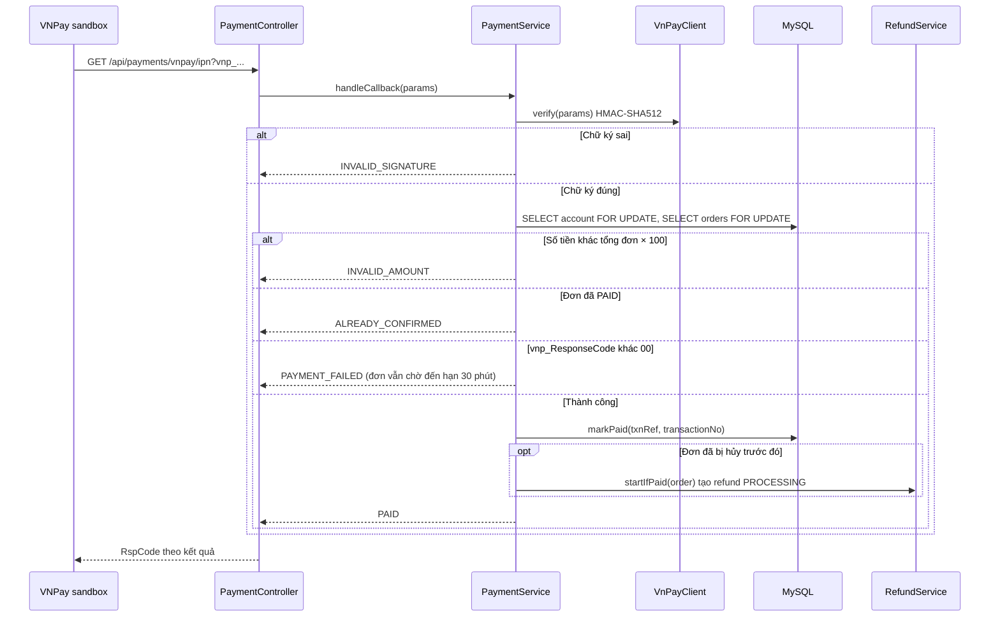
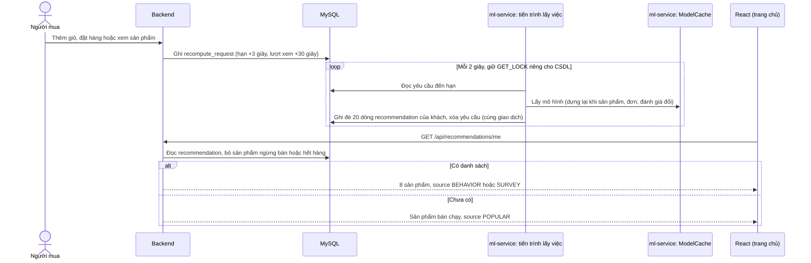
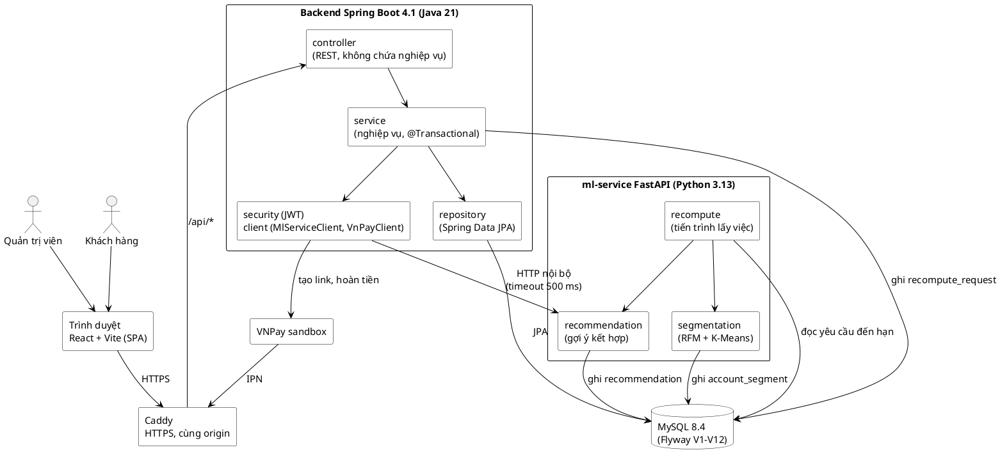
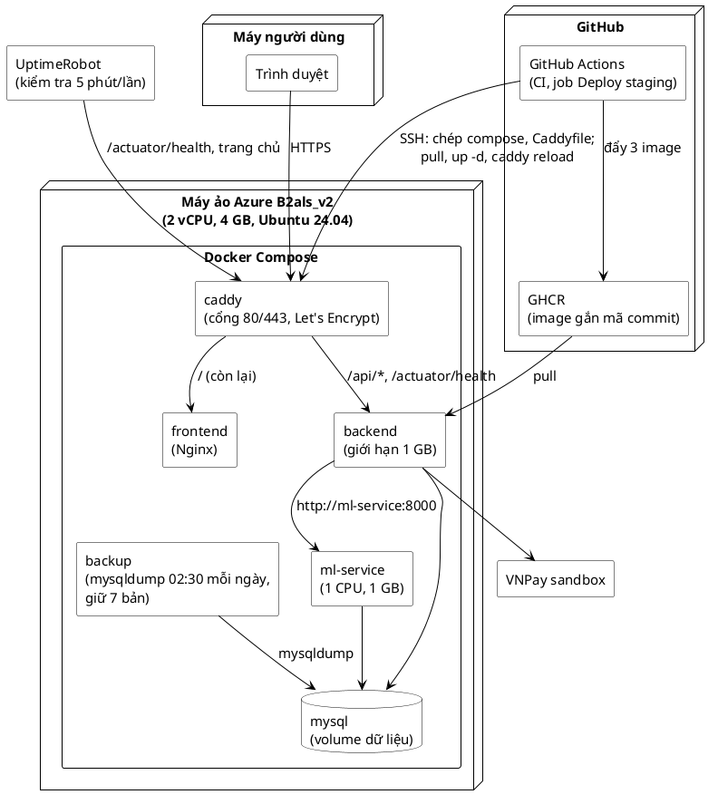
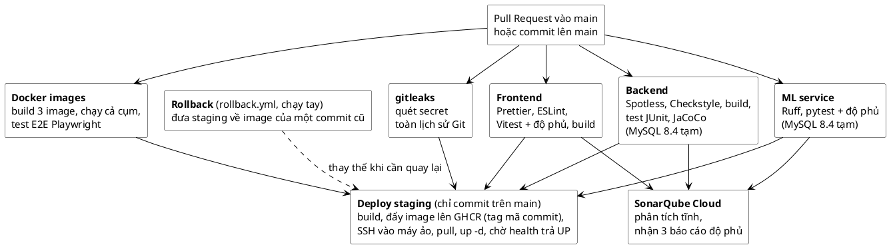

# ĐẶC TẢ YÊU CẦU VÀ THIẾT KẾ HỆ THỐNG (SRS_SDD.MD)

> Phục vụ TC2.1. Đề tài: Website bán hàng có tích hợp học máy trong gợi ý mua hàng và phân nhóm khách hàng. Sinh viên: Đoàn Ngọc Mạnh (23110124).

- **Bản này đối chiếu với:** nhánh `main` tại commit `230c757` (07/11/2026, lần merge gần nhất tính đến 12/11/2026), lược đồ CSDL Flyway V1–V12. Từ lần đối chiếu đầy đủ trên commit `c415b14` (06/11/2026) đến nay không đổi API, route của frontend hay migration; mã chỉ đổi ở ml-service (thêm "đang bán chạy" vào gợi ý, ghi ở US-13) và script đánh giá trên dữ liệu H&M.
- **Nguồn:** Mục 1–4 (trừ 1.10 và 4.7) chép nguyên văn từ `docs/dac-ta-yeu-cau.md` (bản đặc tả được cập nhật cùng từng PR). Ngày 06/11/2026 file đó được bổ sung tiêu chí chấp nhận của US-23 và BR-37 đến BR-42 (trước đó chỉ có trong báo cáo). Các sơ đồ ở Mục 5 được vẽ lại bằng Mermaid và PlantUML để đọc được ngay trên GitHub và sửa được bằng văn bản. Sơ đồ ERD sinh tự động từ CSDL sau khi chạy 12 migration. Mục 6 viết lại ngày 12/11/2026 theo bộ metric K1–K8 của bản cam kết, thay bản nháp KPI cũ.
- **Số mục trong phần chép:** khi phần chép nhắc "Mục 8", "Mục 10", "Mục 11" hay "Hình 6b", đó là số mục và số hình của `docs/dac-ta-yeu-cau.md`; sơ đồ tương ứng trong file này nằm ở Mục 5.
- **Ký hiệu:** US = user story, AC = tiêu chí chấp nhận, BR = quy tắc nghiệp vụ, NFR = yêu cầu phi chức năng. **\[Giả định\]** đánh dấu chỗ chưa có căn cứ bên ngoài, sinh viên tự chọn.

## 0. Đối chiếu với yêu cầu của Khoa

| Yêu cầu | Vị trí trong file này | Tình trạng |
|---|---|---|
| 100% use case có tiêu chí chấp nhận | Mục 1: US-01 đến US-26, mỗi US có danh sách "Tiêu chí chấp nhận"; Mục 1.10 nối từng US với API và test | 26/26 US có AC |
| Quy tắc nghiệp vụ | Mục 2: BR-01 đến BR-49 | Đủ |
| Từ điển dữ liệu | Mục 3: 32 bảng, khớp 32 bảng tạo bởi Flyway V1–V12 | Đã đối chiếu 06/11; đến 12/11 không có migration mới |
| ≥ 5 yêu cầu phi chức năng định lượng | Mục 4: NFR-01 đến NFR-06, kèm số đo ngày 04/11 | 6 NFR, đều có ngưỡng số |
| ≥ 4 loại sơ đồ (Mermaid hoặc PlantUML) | Mục 5: use case, hoạt động, ERD, tuần tự (4 luồng), thành phần, triển khai, CI/CD | 7 loại |
| Khớp mã nguồn | Mục 1.10 (US → API → test), Mục 5.3 (ERD sinh từ CSDL thật), Mục 7 | Đối chiếu đầy đủ 06/11, kiểm lại phần thay đổi 12/11 |

## 1. Use case và tiêu chí chấp nhận
### Epic 1 — Duyệt & tìm sản phẩm (không cần tài khoản)

**US-01: Xem danh mục sản phẩm** Là khách (đã hoặc chưa đăng nhập), tôi muốn xem danh sách sản phẩm theo danh mục, để duyệt các lựa chọn phù hợp. Tiêu chí chấp nhận:

- Xem được danh sách sản phẩm không cần đăng nhập  
- Lọc được theo danh mục, khoảng giá, thương hiệu, mức đánh giá  
- Sắp xếp được theo giá, mới nhất, phổ biến  
- Phân trang hoặc cuộn vô hạn khi danh sách dài

**US-02: Tìm kiếm sản phẩm theo từ khóa** Là khách, tôi muốn tìm sản phẩm bằng từ khóa, để nhanh chóng tìm đúng sản phẩm mình cần. Tiêu chí chấp nhận:

- Ô tìm kiếm hiển thị ở mọi trang  
- Kết quả khớp theo tên sản phẩm, danh mục, thương hiệu  
- Hiển thị "không tìm thấy kết quả" kèm gợi ý liên quan khi không khớp  
- Đây là luồng tìm kiếm chính (không phải phụ): 47% người khảo sát ưu tiên tìm bằng từ khóa khi tìm sản phẩm — nguồn: khảo sát 30 người dùng, `khao-sat-va-phong-van-nguoi-dung.md` Mục A

**US-03: Xem chi tiết sản phẩm** Là khách, tôi muốn xem đầy đủ thông tin một sản phẩm, để quyết định có mua hay không. Tiêu chí chấp nhận:

- Hiển thị ảnh, giá, mô tả, các phân loại còn hàng  
- Hiển thị rõ trạng thái hết hàng nếu có  
- Hiển thị mục "Gợi ý sản phẩm liên quan" (xem US-12)  
- Hệ thống ghi lại lượt xem sản phẩm của tài khoản **đã đăng nhập** (tài khoản, sản phẩm, thời điểm) — dữ liệu đầu vào cho ngưỡng "đã xem ≥5 sản phẩm/30 ngày" ở BR-19 và cho gợi ý cá nhân hóa ở US-13. Không ghi lượt xem của khách chưa đăng nhập, nhất quán với BR-06 (không xử lý định danh khách vãng lai ở server)

### Epic 2 — Tài khoản người dùng

**US-04: Đăng ký tài khoản** Là khách, tôi muốn tạo tài khoản, để có thể mua hàng và theo dõi đơn hàng sau này. Tiêu chí chấp nhận:

- Đăng ký bằng email \+ mật khẩu \+ họ và tên (bắt buộc — cần hiển thị "tên" khách hàng ở US-18)  
- Validate định dạng email, độ mạnh mật khẩu tối thiểu  
- Báo lỗi rõ ràng nếu email đã tồn tại  
- Đăng ký thành công → tự động đăng nhập hoặc chuyển sang trang đăng nhập  
- Có trường giới tính, ngày sinh/độ tuổi (tùy chọn, không bắt buộc) — phục vụ mở rộng phân nhóm khách hàng theo đặc trưng nhân khẩu học (xem `giai-thich-machine-learning.md`); để tùy chọn vì ép khai báo ngay lúc đăng ký dễ giảm tỷ lệ đăng ký thành công  
- Tài khoản tạo qua form này **luôn luôn** có vai trò Khách hàng — không có cách nào tự chọn/tự gán vai trò Admin qua đăng ký công khai (xem BR-04)

**US-05: Đăng nhập** Là người dùng đã có tài khoản, tôi muốn đăng nhập, để truy cập giỏ hàng/đơn hàng của mình. Tiêu chí chấp nhận:

- Đăng nhập bằng email \+ mật khẩu  
- Báo lỗi chung chung khi sai thông tin (không lộ email có tồn tại hay không, tránh dò tài khoản)  
- Có chức năng "quên mật khẩu" (đặc tả ở US-04, US-05)  
- Sau đăng nhập, quay lại đúng trang đang thao tác dở (vd đang ở giữa checkout)  
- Thời hạn phiên đăng nhập (JWT): 24 giờ — xem NFR-03 (Mục 12\) **\[Giả định\]**. Link đặt lại mật khẩu: hết hạn sau 30 phút, dùng 1 lần (BR-47)

### Epic 3 — Giỏ hàng & đặt hàng

**US-06: Thêm sản phẩm vào giỏ hàng** Là khách (đã hoặc chưa đăng nhập), tôi muốn thêm sản phẩm vào giỏ hàng, để gom nhiều sản phẩm trước khi thanh toán. Tiêu chí chấp nhận:

- Thêm được khi chưa đăng nhập (giỏ hàng lưu tạm theo phiên/trình duyệt)  
- Chọn được phân loại (nếu sản phẩm có) và số lượng trước khi thêm  
- Không cho thêm quá số lượng tồn kho *(kiểm tra này chỉ mang tính tham khảo tại thời điểm thêm giỏ hàng — kiểm tra thật sự, có tính ràng buộc, diễn ra ở bước xác nhận đơn hàng, xem BR-08)*  
- Giỏ hàng của khách chưa đăng nhập được giữ lại khi đăng nhập/đăng ký (merge giỏ hàng, không mất dữ liệu)

**US-07: Xem & chỉnh sửa giỏ hàng** Là khách, tôi muốn xem và chỉnh sửa giỏ hàng, để kiểm soát đúng những gì mình sắp mua. Tiêu chí chấp nhận:

- Xem danh sách sản phẩm, số lượng, đơn giá, tổng tiền  
- Sửa số lượng hoặc xóa từng sản phẩm  
- Tổng tiền cập nhật ngay khi thay đổi  
- Dưới giỏ có khối "Thường được mua cùng" (bổ sung 31/10/2026): tối đa 4 sản phẩm còn hàng hay được mua kèm các sản phẩm trong giỏ, mỗi sản phẩm kèm lý do, lấy từ ma trận "hay mua cùng" của mô hình gợi ý (US-12, US-13); chưa ai mua cùng thì ẩn khối, không lấp bằng sản phẩm bán chạy

**US-08: Bắt đầu thanh toán — yêu cầu đăng nhập nếu chưa có tài khoản** Là khách chưa đăng nhập, khi tôi bấm "Mua hàng" từ giỏ hàng, tôi được yêu cầu đăng nhập hoặc đăng ký trước khi tiếp tục, để hệ thống gắn đơn hàng với đúng tài khoản của tôi. Tiêu chí chấp nhận:

- Bấm "Thanh toán" khi chưa đăng nhập → chuyển đến màn hình đăng nhập/đăng ký  
- Sau khi đăng nhập/đăng ký thành công, quay lại đúng bước thanh toán với giỏ hàng giữ nguyên  
- Khách đã đăng nhập bấm "Thanh toán" → vào thẳng luồng thanh toán, không hỏi lại

### Epic 4 — Thanh toán

**US-09: Nhập thông tin giao hàng** Là người mua, tôi muốn nhập địa chỉ giao hàng, để đơn hàng được giao đúng nơi. Tiêu chí chấp nhận:

- Nhập/chọn địa chỉ (có thể lưu nhiều địa chỉ cho lần sau)  
- Validate các trường bắt buộc (tên người nhận, SĐT, địa chỉ)

**US-10: Chọn phương thức thanh toán & xác nhận đơn hàng** Là người mua, tôi muốn chọn phương thức thanh toán và xác nhận đơn hàng, để hoàn tất việc mua hàng. Tiêu chí chấp nhận:

- Hiển thị tối thiểu 1 phương thức thanh toán online \+ COD (thanh toán khi nhận hàng) — cổng thanh toán cụ thể (vd VNPay sandbox) quyết định ở thiết kế kỹ thuật  
- Hiển thị tóm tắt đơn hàng (sản phẩm, phí ship nếu có — BR-35, tổng tiền) trước khi xác nhận, dùng giá hiện tại (không dùng giá đã cache lúc thêm giỏ hàng)  
- Sau khi xác nhận: tạo đơn hàng, trừ tồn kho, xóa giỏ hàng, hiển thị trang xác nhận thành công kèm mã đơn hàng  
- Rẽ nhánh theo phương thức: **COD** → đơn vào thẳng "Chờ xử lý". **ONLINE** → `payment_status` \= PENDING, chuyển hướng khách sang cổng thanh toán; đơn chỉ thật sự "đã thanh toán" khi có callback xác nhận (`payment_status` → PAID). Nếu khách bỏ ngang, đơn tự hủy sau một thời hạn — xem BR-34  
- Bấm "Xác nhận đơn hàng" nhiều lần (mất mạng, bấm lại...) không được tạo thành nhiều đơn hàng riêng biệt — xem BR-10

### Epic 5 — Lịch sử & theo dõi đơn hàng

**US-11: Xem lịch sử đơn hàng** Là người mua, tôi muốn xem lại các đơn hàng đã đặt, để theo dõi trạng thái và tra cứu khi cần. Tiêu chí chấp nhận:

- Danh sách đơn hàng sắp xếp mới nhất trước  
- Xem chi tiết từng đơn: sản phẩm, trạng thái, ngày đặt, tổng tiền — thông tin sản phẩm hiển thị đúng như tại thời điểm mua, kể cả khi sản phẩm sau này đổi giá/đổi tên/ngừng bán (xem BR-15)  
- Trạng thái cập nhật khi tải lại trang (không cần real-time phức tạp)

**US-20: Tự hủy đơn hàng** Là người mua, tôi muốn tự hủy đơn hàng của mình khi đơn chưa được giao, để không phải chờ liên hệ admin khi đổi ý hoặc đặt nhầm. Tiêu chí chấp nhận:

- Hủy được khi đơn đang ở trạng thái "Chờ xử lý" hoặc "Đang xử lý"  
- Không hủy được khi đơn đã chuyển "Đang giao" hoặc "Đã giao" — hiển thị rõ lý do (đơn đã rời kho, không thể tự hủy qua hệ thống nữa; liên hệ shop nếu cần hỗ trợ thêm)  
- Sau khi hủy: tồn kho được hoàn lại (BR-16), đơn chuyển trạng thái "Đã hủy"  
- Nếu đơn đã thanh toán online: hệ thống tự động khởi tạo hoàn tiền 100% ngay khi hủy, hiển thị trạng thái hoàn tiền riêng cho khách theo dõi — chính sách đầy đủ xem BR-28  
- Nếu đơn có áp dụng mã giảm giá, lượt dùng mã đó được hoàn lại cho tài khoản khi hủy (xem BR-33)

### Epic 6 — Gợi ý sản phẩm cá nhân hóa (nội dung ML chính)

**US-12: Xem gợi ý sản phẩm liên quan trên trang chi tiết sản phẩm** Là người mua, khi xem một sản phẩm, tôi muốn thấy gợi ý các sản phẩm tương tự/liên quan, để khám phá thêm lựa chọn phù hợp gu của mình. Tiêu chí chấp nhận:

- Hiển thị ≥4 sản phẩm gợi ý dựa trên **độ tương đồng thuộc tính sản phẩm** (content-based filtering, cosine similarity trên vector thuộc tính) — đây là phép so sánh sản phẩm↔sản phẩm, không phụ thuộc lịch sử riêng của người xem, nên hoạt động giống nhau cho cả khách chưa đăng nhập lẫn đã đăng nhập, không có vấn đề cold-start ở story này (khác US-13)  
- Không gợi ý lại chính sản phẩm đang xem hoặc sản phẩm đã hết hàng  
- Nếu số sản phẩm tương tự còn hàng không đủ 4, lấp đầy phần còn thiếu bằng sản phẩm bán chạy nhất (xem BR-22)  
- Mỗi sản phẩm gợi ý hiển thị kèm 1 lý do ngắn, dễ hiểu (vd "Cùng danh mục với sản phẩm bạn đang xem", "Cùng thương hiệu") — không cần công thức toán học cho người dùng cuối, nhưng cơ chế tính toán đầy đủ (cosine similarity) phải giải thích được khi cần. Mẫu câu lý do cụ thể chốt ở giai đoạn cài đặt mô hình

**US-13: Xem gợi ý cá nhân hóa trên trang chủ** Là người mua đã đăng nhập và có lịch sử xem/mua, tôi muốn thấy một khu vực gợi ý riêng trên trang chủ, để nhanh tìm sản phẩm hợp gu mà không cần tự tìm kiếm. Tiêu chí chấp nhận:

- Chỉ hiển thị khi đã có đủ dữ liệu hành vi (xem ngưỡng ở BR-19); chưa đủ dữ liệu thì hiển thị sản phẩm phổ biến thay thế (tránh khu vực trống)  
- Gợi ý tính sẵn, cập nhật vài giây sau hành động rõ ý và khoảng 30 giây sau lượt xem (xem BR-20); mở trang chủ không phải chờ tính. Trang chủ có thêm hàng "Vì bạn vừa xem / vừa thêm vào giỏ …" gồm sản phẩm liên quan của hành động gần nhất trong 24 giờ, đổi ngay theo từng hành động; trong lúc danh sách đang được tính lại, trang chủ báo "Đang cập nhật" và tự tải lại, sản phẩm mới so với lần khách thấy trước có nhãn "Mới"  
- Tín hiệu hành vi đầu vào phân cấp trọng số theo **loại hành vi**: đã mua (5) \> đã thêm giỏ hàng (3) \> yêu thích (2) \> chỉ xem (1), lấy từ các bảng đơn hàng, giỏ hàng, yêu thích và nhật ký xem ở Mục 3; không đo thời gian xem (dwell time) vì cần cơ chế tracking phức tạp và dễ nhiễu. Tương tác càng gần đây càng nặng: trọng số nhân thêm (1 + 3 · 0,5^(tuổi tính bằng ngày)). Các số này nằm ở `INTERACTION_WEIGHTS`, `RECENT_BOOST`, `RECENT_HALF_LIFE_DAYS` trong `ml-service/app/recommendation/model.py` **\[Giả định\]**
- Điểm của mỗi sản phẩm = 0,7 · độ giống hồ sơ sở thích (lọc theo nội dung) + 0,2 · hay mua cùng + 0,1 · bán chạy mọi thời điểm + 1 · đang bán chạy + 0,15 · điểm hợp khảo sát; mỗi sản phẩm cùng danh mục đã được chọn trước đó trừ 0,05 để danh sách đa dạng (`model.Weights`). "Đang bán chạy" (`trending.py`, thêm 06/11/2026) cộng lượt bán 30 ngày trước lúc gợi ý, lượt bán càng cũ càng nhẹ (bán rã 7 ngày), và thu nhỏ khi sản phẩm bán chạy nhất chưa tới 20 lượt để cửa hàng ít đơn không bị lượt bán lẻ chi phối. Trọng số w_t = 1 và chu kỳ 7 ngày chọn trên tuần kiểm định của dữ liệu mua hàng thật H&M, các trọng số khác chọn trên dữ liệu mô phỏng; kết quả kiểm chứng ở `data/hm/` và Mục 6 (K1)

**US-23: Khảo sát sở thích lần đầu cho người dùng mới** *(bổ sung 07/10/2026 theo yêu cầu của GVHD; cài đặt 22/10/2026, migration V5; hỏi kỹ hơn từ 04/11/2026, migration V11, V12)* Là khách mới chưa có lịch sử mua hay xem, tôi muốn trả lời vài câu hỏi ngắn về nhu cầu, để thấy ngay gợi ý hợp với mình thay vì chỉ thấy sản phẩm bán chạy. Tiêu chí chấp nhận:

- Trang chủ mời khách chưa có dữ liệu làm khảo sát (trang `/survey`); khách bỏ qua được, hệ thống ghi trạng thái SKIPPED và không hỏi lại
- Câu hỏi rẽ nhánh theo câu trả lời trước (mua cho bản thân hay tìm quà, đồ nam hay đồ nữ, loại sản phẩm, dịp sử dụng, thương hiệu, khoảng giá, kiểu người mua); cây câu hỏi lưu trong CSDL, backend kiểm tra đúng thứ tự câu, số đáp án và thương hiệu được đề nghị
- Kết quả hiện ngay 8 sản phẩm gợi ý; chọn đồ nam hoặc đồ nữ thì không gợi ý sản phẩm của giới tính kia (BR-41, BR-42); sản phẩm trong khoảng giá khách chọn đứng trước
- Khách chưa đăng nhập vẫn làm được; kết quả lưu ở trình duyệt và được gửi lên tài khoản ngay lần đầu tải trang sau khi đăng nhập
- Nhánh tìm quà chỉ xem kết quả, không lưu vào sở thích của tài khoản (BR-42)
- Lưu khảo sát ghi yêu cầu tính lại gợi ý (BR-20); khi khách đã có hành vi đủ ngưỡng (BR-19), gợi ý trang chủ chuyển sang dựa trên hành vi
- ml-service lỗi hoặc chậm quá 500 ms thì dùng gợi ý theo quy tắc, vẫn đủ 8 sản phẩm (BR-22)

### Epic 7 — Tính năng phụ, ưu tiên thấp (có thể cắt nếu thiếu thời gian)

**US-14: Lưu sản phẩm vào danh sách yêu thích (wishlist)** Là người mua đã đăng nhập, tôi muốn lưu sản phẩm vào danh sách yêu thích, để xem lại sau mà không cần tìm lại. Tiêu chí chấp nhận: thêm/xóa khỏi wishlist; xem danh sách wishlist riêng. Cài đặt (31/10/2026): nút "Yêu thích" ở trang chi tiết sản phẩm (khách chưa đăng nhập bấm thì đăng nhập rồi quay lại) và trang "Yêu thích" riêng, sản phẩm thêm sau đứng trước; ghi ở cấp sản phẩm, thêm lại hay bỏ sản phẩm không có trong danh sách thì không làm gì; tối đa 100 sản phẩm **\[Giả định\]**; sản phẩm hết hàng vẫn hiện, sản phẩm đã ngừng bán thì ẩn (dòng vẫn giữ); thêm/bỏ yêu cầu tính lại gợi ý như hành động rõ ý (BR-20).

**US-15: Đánh giá sản phẩm đã mua** Là người mua đã nhận hàng, tôi muốn đánh giá sản phẩm, để chia sẻ trải nghiệm và giúp người mua sau. Tiêu chí chấp nhận: chỉ đánh giá được sản phẩm đã có đơn hàng hoàn tất; có điểm sao \+ nhận xét text. Cài đặt (31/10/2026): phần "Đánh giá sản phẩm" ở trang chi tiết (điểm trung bình, số đánh giá theo từng mức sao, danh sách sửa gần nhất trước, mỗi lần 5 đánh giá) và ô đánh giá cho khách đã nhận hàng; đơn Đã giao có link "Đánh giá sản phẩm" ở từng dòng. Nhận xét tối đa 1.000 ký tự, không bắt buộc; người đánh giá chỉ hiện tên gọi (chữ cuối của họ tên) **\[Giả định\]**; đánh giá gắn với dòng đơn Đã giao mới nhất có sản phẩm đó.

**US-21: Áp dụng mã giảm giá khi thanh toán** Là người mua, tôi muốn nhập mã giảm giá khi thanh toán, để được giảm giá cho đơn hàng. Tiêu chí chấp nhận:

- Có ô nhập mã giảm giá ở bước xác nhận đơn hàng (US-10)  
- Hệ thống kiểm tra mã hợp lệ: còn hạn sử dụng, chưa vượt giới hạn lượt dùng (tổng và/hoặc riêng tài khoản này), đơn hàng đạt giá trị tối thiểu nếu mã có yêu cầu (xem BR-30)  
- Báo lỗi rõ ràng nếu mã không hợp lệ/hết hạn/hết lượt dùng — không chặn khách tiếp tục thanh toán mà không dùng mã  
- Hiển thị rõ số tiền được giảm trước khi xác nhận đơn hàng, tách riêng khỏi tổng tiền hàng và phí vận chuyển (xem BR-32)  
- Mỗi đơn hàng áp dụng tối đa 1 mã giảm giá (xem BR-31)

Cài đặt (31/10/2026): ô "Mã giảm giá" nằm trong phần tóm tắt ở trang thanh toán; bấm "Áp dụng" thì tóm tắt tính lại (dòng "Giảm giá (MÃ)" tách riêng khỏi tiền hàng và phí vận chuyển) hoặc hiện lý do mã không dùng được (sai mã, đã ngừng, chưa tới ngày, hết hạn, hết lượt, khách đã dùng đủ lượt, đơn còn thiếu bao nhiêu tiền mới đủ mức tối thiểu), khách vẫn đặt được đơn không có mã. Mã không phân biệt hoa thường, lưu dạng chữ hoa. Đơn hàng và trang chi tiết đơn ghi mã đã dùng. Phí vận chuyển tính trên tiền hàng trước giảm giá (BR-35). Lượt dùng mỗi khách đếm các đơn chưa hủy của khách đó với mã này.

**US-22: Quản lý mã giảm giá** Là admin, tôi muốn tạo/sửa/vô hiệu hóa mã giảm giá, để chạy các chương trình khuyến mãi. Tiêu chí chấp nhận:

- Tạo mã mới: mã code, loại (phần trăm hoặc số tiền cố định), giá trị, đơn hàng tối thiểu (tùy chọn), thời hạn hiệu lực, giới hạn lượt dùng (tổng và/hoặc theo từng khách hàng)  
- Xem danh sách mã đã tạo kèm số lượt đã dùng / còn lại  
- Vô hiệu hóa mã trước hạn nếu cần dừng chương trình khuyến mãi sớm  
- Chỉ admin mới truy cập được (kiểm tra phân quyền, cùng US-16/17)

Cài đặt (31/10/2026): trang quản trị "Mã giảm giá" (nhóm Bán hàng). Mã phần trăm có thêm trần giảm tối đa (`max_discount_amount`, migration V2), mã số tiền cố định không có trần. Thời hạn tính theo **giờ Việt Nam** (máy chủ Docker chạy giờ UTC). Sửa mã không đổi số tiền đã giảm của đơn cũ; mã đã có người dùng thì không đổi được chuỗi mã. Danh sách hiện tình trạng: Đang áp dụng, Chưa tới ngày, Đã hết hạn, Đã hết lượt, Đã ngừng.

### Epic 8 — Quản trị (Admin)

**US-16: Quản lý sản phẩm (CRUD)** Là admin, tôi muốn thêm/sửa/xóa sản phẩm, để duy trì catalog cập nhật. Tiêu chí chấp nhận:

- Thêm sản phẩm mới với thuộc tính chung (tên, mô tả, danh mục, thương hiệu, ảnh) kèm tối đa 2 tầng phân loại do admin tự đặt tên (vd Màu sắc, Kích cỡ) và **ít nhất 1 biến thể** (một tổ hợp giá trị phân loại; sản phẩm không có phân loại thì đúng 1 biến thể); mỗi biến thể có giá và tồn kho riêng (mô hình SKU, xem BR-05)  
- Sửa/xóa sản phẩm hiện có — xóa mềm (soft delete) nếu sản phẩm đã có trong đơn hàng cũ, để không phá dữ liệu lịch sử  
- Sản phẩm bị xóa mềm hoặc hết hàng hoàn toàn khi đang nằm trong giỏ hàng của khách khác → tự động loại khỏi giỏ hàng đó kèm thông báo (xem BR-11)  
- Chỉ admin mới truy cập được (kiểm tra phân quyền)

**US-17: Quản lý đơn hàng** Là admin, tôi muốn xem danh sách đơn hàng và cập nhật trạng thái, để xử lý vận hành. Tiêu chí chấp nhận:

- Xem danh sách đơn hàng, lọc theo trạng thái  
- Cập nhật trạng thái đơn hàng (vd: đang xử lý → đang giao → đã giao; hoặc chuyển "Đã hủy" thay khách trong các trường hợp không tự phục vụ được, vd từ chối nhận COD — xem BR-13)  
- Xem trạng thái hoàn tiền của từng đơn đã hủy (Đang hoàn tiền/Đã hoàn tiền/Hoàn tiền thất bại); với đơn "Hoàn tiền thất bại", admin xử lý thủ công qua cổng thanh toán hoặc liên hệ khách (xem BR-28)

**US-18: Xem danh sách khách hàng** Là admin, tôi muốn xem danh sách khách hàng đã đăng ký, để tra cứu và hiểu ai đang mua hàng trên hệ thống. Tiêu chí chấp nhận:

- Xem danh sách khách hàng: tên, email, ngày đăng ký, số đơn hàng đã đặt  
- Tìm kiếm theo tên hoặc email  
- Xem chi tiết 1 khách hàng: lịch sử đơn hàng, nhóm phân cụm hiện tại nếu đã có (liên kết US-19)

### Epic 9 — Phân nhóm khách hàng (Admin, nội dung ML chính)

**US-19: Xem kết quả phân nhóm khách hàng** Là admin, tôi muốn xem khách hàng đã được phân vào những nhóm nào (theo RFM \+ K-Means) kèm diễn giải ý nghĩa từng nhóm, để hiểu chân dung khách hàng và ra quyết định kinh doanh (vd ưu đãi riêng cho nhóm khách thân thiết). Tiêu chí chấp nhận:

- Hiển thị danh sách nhóm khách hàng, số lượng khách/nhóm, đặc điểm mô tả từng nhóm (không chỉ số cụm vô nghĩa)  
- Xem được một khách hàng cụ thể thuộc nhóm nào (qua trang chi tiết khách hàng ở US-18)  
- Kết quả phân nhóm giải thích được khi được hỏi, không phải hộp đen

**US-25: Xem hồ sơ một nhóm khách hàng** *(bổ sung 31/10/2026)* Là admin, tôi muốn mở từng nhóm khách hàng để xem nhóm đó mang lại bao nhiêu doanh thu, mua theo nhịp nào, mua gì, gồm những ai, và khách nào trong nhóm đã lâu chưa quay lại, để biết nhóm nào cần chăm sóc và chăm sóc ai trước. Tiêu chí chấp nhận:

- Trang tổng quan phân nhóm hiện thêm doanh thu và tỷ lệ doanh thu của từng nhóm; mỗi nhóm mở được trang hồ sơ riêng  
- Hồ sơ nhóm có: số khách và tỷ lệ, doanh thu và tỷ lệ, số đơn Đã giao, giá trị đơn trung bình, nhịp mua (số ngày trung bình giữa 2 đơn liên tiếp), thời gian gắn bó trung bình, 5 danh mục mua nhiều nhất, phân bố giới tính và nhóm tuổi (khách chưa khai hiện riêng là "Chưa khai")  
- Hồ sơ có danh sách khách cần chăm sóc theo BR-44, mỗi khách mở được trang chi tiết khách hàng (US-18)  
- Chỉ tính đơn Đã giao, như R, F, M (BR-23)

**US-24: Tự động tặng mã giảm giá theo nhóm khách hàng** *(bổ sung 31/10/2026; gồm tặng mã ngay cho cả nhóm hoặc khách cần chăm sóc và chương trình tự tặng mã cho khách mới vào nhóm)* Là admin, tôi muốn hệ thống gợi ý việc nên làm với từng nhóm khách, tặng mã giảm giá riêng cho cả nhóm hoặc cho khách cần chăm sóc, và bật cho một nhóm chương trình tự tặng mã để mỗi khách vừa được xếp vào nhóm nhận ưu đãi đúng lúc, rồi xem bao nhiêu khách quay lại mua, để biết ưu đãi có đáng tiền giảm hay không. Tiêu chí chấp nhận:

*Tặng mã ngay:*

- Mỗi nhóm có mục tiêu chăm sóc (hiện ở trang tổng quan phân nhóm) và ưu đãi gợi ý tính theo thói quen của chính nhóm (vd đơn tối thiểu theo giá trị đơn trung bình của nhóm), kèm đối tượng gợi ý: cả nhóm hoặc khách cần chăm sóc (BR-44)
- Admin tặng mã bằng biểu mẫu mã giảm giá đã điền sẵn ưu đãi gợi ý, sửa được trước khi tặng; danh sách khách được tặng chốt lúc tặng
- Mã tặng là mã riêng: chỉ khách được tặng dùng được (BR-43); khách thấy mã ở trang "Ưu đãi của bạn" và chọn mã bằng 1 lần bấm ở trang thanh toán
- Kết quả mỗi lần tặng: số khách được tặng, số khách đã đặt đơn với mã và tỷ lệ, số đơn, doanh thu, tổng tiền đã giảm, doanh thu trên mỗi đồng giảm (chỉ tính đơn chưa hủy)

*Tự tặng mã cho khách mới vào nhóm:*

- Admin bật chương trình ở hồ sơ nhóm bằng biểu mẫu mã giảm giá điền sẵn ưu đãi gợi ý, kèm số ngày mỗi khách được dùng mã kể từ lúc nhận; thời hạn của mã là thời gian chạy chương trình
- Chỉ khách vào nhóm **sau** lúc bật mới nhận mã (khách đang ở trong nhóm lúc bật thì dùng "Tặng mã cho cả nhóm"); mỗi khách nhận tối đa 1 lần cho mỗi chương trình (BR-43)
- Khách nhận mã chậm nhất khoảng 1 phút sau khi được xếp vào nhóm; mã hiện ở "Ưu đãi của bạn", ở trang thanh toán và ở dải báo trên trang chủ
- Mỗi nhóm có tối đa 1 chương trình đang chạy; admin dừng được, khách đã nhận vẫn dùng được đến hạn riêng
- Kết quả của chương trình hiện cùng bảng kết quả các lần tặng mã, số khách được tặng tăng dần theo thời gian

**US-13 (mở rộng): Thử nghiệm A/B gợi ý học máy so với sản phẩm bán chạy** *(bổ sung 31/10/2026)* Là admin, tôi muốn chia khách thành 2 nhóm ngẫu nhiên, một nhóm thấy gợi ý học máy và một nhóm thấy sản phẩm bán chạy ở cùng chỗ trên trang chủ, rồi so sánh tỷ lệ bấm và tỷ lệ mua của 2 nhóm, để có bằng chứng bằng số rằng gợi ý học máy hiệu quả hơn cách đơn giản nhất. Tiêu chí chấp nhận:

- Admin bắt đầu thử nghiệm ở trang "Hiệu quả gợi ý" với tên và tỷ lệ khách vào nhóm gợi ý (10-90%, mặc định 50%); mỗi lúc chỉ chạy 1 thử nghiệm, admin dừng được bất cứ lúc nào
- Khi thử nghiệm chạy, khách đã có danh sách gợi ý riêng được chia nhóm ở lần đầu mở trang chủ, cố định trong suốt thử nghiệm (BR-46): nhóm A (gợi ý học máy) thấy danh sách học máy, nhóm B (bán chạy) thấy sản phẩm bán chạy trong cùng khối "Gợi ý cho bạn", trừ sản phẩm đã mua hoặc đang trong giỏ như danh sách học máy. Hai nhóm thấy cùng một giao diện: không có hàng "Vì bạn vừa xem", cùng dòng mô tả, không lý do gợi ý, giờ cập nhật hay nhãn "Mới" *(sửa 04/11/2026)*; khách không được báo mình thuộc nhóm nào
- Khách chưa có danh sách gợi ý riêng không tham gia (cả 2 nhóm đều sẽ thấy sản phẩm bán chạy, không có gì để so); sản phẩm liên quan ở trang chi tiết, giỏ hàng và kết quả khảo sát không đổi
- Kết quả theo từng nhóm: số khách, lượt hiện, lượt bấm, tỷ lệ bấm, tỷ lệ khách bấm ít nhất 1 lần, tỷ lệ khách đặt hàng, tỷ lệ khách mua sản phẩm đã bấm từ gợi ý, số đơn, doanh thu và doanh thu trên mỗi khách; chỉ tính hành động từ lúc khách được chia nhóm đến lúc dừng
- Mỗi tỷ lệ theo khách có chênh lệch A − B, giá trị p và kết luận (BR-46); xem lại được kết quả của các thử nghiệm đã dừng
- Cùng trang có bảng tỷ lệ bấm theo vị trí và nguồn gợi ý trong 7, 30 hoặc 90 ngày gần nhất

**US-26: Xem trang tổng quan (bảng điều khiển của Quản trị viên)** *(bổ sung 31/10/2026)* Là admin, tôi muốn mở trang quản trị là thấy ngay tình hình cửa hàng trong một khoảng ngày: doanh thu, đơn hàng, sản phẩm bán chạy và hiệu quả gợi ý, để biết cửa hàng đang thế nào mà không phải mở từng trang. Tiêu chí chấp nhận:

- Trang `/admin` là bảng điều khiển (mục "Bảng điều khiển", nhóm "Tổng quan" đầu menu); mặc định 30 ngày gần nhất, chọn nhanh 7, 30, 90 ngày hoặc chọn ngày tự do, tối đa 366 ngày; ngày bắt đầu sau ngày kết thúc thì báo lỗi, không tải
- Ngày tính theo giờ Việt Nam. Số tổng: doanh thu, số đơn đã giao, giá trị đơn trung bình, số đơn đặt (mọi trạng thái), số khách hàng mới (BR-45)
- Biểu đồ cột doanh thu theo ngày (ngày không có đơn là 0), rê chuột hoặc Tab vào cột để xem số, có dạng bảng
- Số đơn theo 5 trạng thái kèm tỷ lệ; 10 sản phẩm bán nhiều nhất trong đơn đã giao (số lượng, tiền hàng), bấm tên để mở trang sửa sản phẩm
- Hiệu quả gợi ý: lượt hiện, lượt bấm, tỷ lệ bấm theo vị trí và theo nguồn, doanh thu từ gợi ý và tỷ lệ của nó trên tiền hàng (BR-45), tóm tắt thử nghiệm A/B đang chạy (US-13) với liên kết sang trang "Hiệu quả gợi ý"

**US-04, US-05 (mở rộng): Hồ sơ cá nhân, đổi mật khẩu và quên mật khẩu** *(bổ sung 31/10/2026)* Là người dùng đã có tài khoản, tôi muốn sửa thông tin cá nhân, đổi mật khẩu và lấy lại mật khẩu khi quên, để tự quản lý tài khoản mà không cần nhờ quản trị viên. Tiêu chí chấp nhận:

- Trang `/profile` (liên kết "Hồ sơ" ở thanh trên cùng, cả Khách hàng lẫn Quản trị viên): sửa họ tên (bắt buộc), giới tính, ngày sinh (phải trước hôm nay); email chỉ xem, không đổi được
- Đổi mật khẩu: nhập mật khẩu hiện tại, mật khẩu mới theo BR-02 và nhập lại; mật khẩu hiện tại sai thì báo lỗi và tính như 1 lần đăng nhập sai (NFR-03); mật khẩu mới trùng mật khẩu hiện tại thì báo lỗi; đổi xong thì mọi liên kết đặt lại mật khẩu chưa dùng mất hiệu lực
- Trang đăng nhập có liên kết "Quên mật khẩu?" dẫn tới `/forgot-password`: nhập email, hệ thống gửi email có liên kết `/reset-password?token=…`; luôn báo "nếu email có tài khoản thì sẽ nhận được thư", kể cả email chưa đăng ký, để không lộ email nào có tài khoản (như US-05)
- Liên kết hết hạn sau 30 phút và chỉ dùng được 1 lần (BR-47); liên kết sai, đã dùng hoặc hết hạn thì báo lỗi kèm nút xin liên kết mới
- Đặt mật khẩu mới thành công thì chuyển về trang đăng nhập với thông báo, đồng thời gỡ khóa đăng nhập tạm thời (NFR-03) của tài khoản đó

---

**Tổng cộng: 22 user story gốc, 100% có acceptance criteria. Bổ sung sau: US-23 (khảo sát lần đầu, tiêu chí chấp nhận ở Epic 6), US-24 (tặng mã theo nhóm khách hàng: tặng ngay và tự tặng cho khách mới vào nhóm), US-25 (hồ sơ nhóm khách hàng), US-26 (trang tổng quan của Quản trị viên); thử nghiệm A/B gợi ý là phần mở rộng của US-13, hồ sơ cá nhân, đổi mật khẩu và quên mật khẩu là phần mở rộng của US-04, US-05. Số US và BR khớp luận văn (Phụ lục A) và bản cam kết.**

### 1.10 Truy vết use case → API → test (đối chiếu mã nguồn ngày 06/11/2026)

API lấy từ các lớp trong `backend/src/main/java/com/manhdn/fashionshop/controller/`; mã test (TC) là mã trong `TEST_PLAN_AND_CASES.MD` Mục 6.

| US | Tên | API chính (backend) | Trang (frontend) | Test |
|---|---|---|---|---|
| US-01 | Xem danh mục sản phẩm | `GET /api/products`, `GET /api/categories`, `GET /api/brands` | `/products` | TC-01 – TC-03 |
| US-02 | Tìm kiếm theo từ khóa | `GET /api/products?keyword=`, `GET /api/products/suggestions` | ô tìm kiếm ở header | TC-04 – TC-06 |
| US-03 | Xem chi tiết sản phẩm | `GET /api/products/{id}`, `POST /api/products/{id}/views` | `/products/:id` | TC-07 – TC-10 |
| US-04 | Đăng ký; hồ sơ cá nhân, đổi mật khẩu (mở rộng) | `POST /api/auth/register`, `PUT /api/auth/me`, `PUT /api/auth/me/password` | `/register`, `/profile` | TC-11 – TC-13, TC-18 |
| US-05 | Đăng nhập; quên mật khẩu (mở rộng) | `POST /api/auth/login`, `GET /api/auth/me`, `POST /api/auth/forgot-password`, `POST /api/auth/reset-password` | `/login`, `/forgot-password`, `/reset-password` | TC-14 – TC-17, TC-19 – TC-21 |
| US-06 | Thêm vào giỏ | `POST /api/cart/items`, `POST /api/cart/preview` | `/products/:id` | TC-22, TC-23, TC-25 |
| US-07 | Xem, sửa giỏ hàng | `GET /api/cart`, `PUT`/`DELETE /api/cart/items/{variantId}`, `GET /api/products/bought-together` | `/cart` | TC-24, TC-27 |
| US-08 | Bắt đầu thanh toán | `POST /api/cart/merge` | `/checkout` | TC-25, TC-26 |
| US-09 | Địa chỉ giao hàng | `/api/addresses` (GET, POST, PUT, DELETE) | `/addresses`, `/checkout` | TC-33 |
| US-10 | Thanh toán, xác nhận đơn | `GET /api/orders/preview`, `POST /api/orders`, `POST /api/orders/{id}/payment-url`, `GET /api/payments/vnpay/return`, `/ipn` | `/checkout`, `/payment/vnpay-return` | TC-28 – TC-31, TC-34 |
| US-11 | Lịch sử đơn hàng | `GET /api/orders`, `GET /api/orders/{id}` | `/orders`, `/orders/:id` | TC-37 |
| US-12 | Sản phẩm liên quan | `GET /api/products/{id}/related` | `/products/:id` | TC-38, TC-39 |
| US-13 | Gợi ý trang chủ; thử nghiệm A/B (mở rộng) | `GET /api/recommendations/me`, `POST /api/recommendations/events`, `/api/admin/ab-tests` (GET, POST, `/{id}`, `/{id}/stop`), `GET /api/admin/recommendations/ctr` | `/`, `/admin/recommendations` | TC-40 – TC-43, TC-50, TC-51 |
| US-14 | Yêu thích | `/api/wishlist` (GET, `/ids`, PUT, DELETE) | `/wishlist` | TC-66 |
| US-15 | Đánh giá sản phẩm | `/api/products/{productId}/reviews` (GET, `/me`), `GET /api/reviews/pending` | `/products/:id`, `/orders/:id` | TC-67 |
| US-16 | Quản lý sản phẩm | `/api/admin/products` (+ `/variants`), `/api/admin/categories`, `/api/admin/brands` | `/admin/products` | TC-61 – TC-63 |
| US-17 | Quản lý đơn hàng | `/api/admin/orders` (GET, `PUT /{id}/status`, `PUT /{id}/refund/complete`) | `/admin/orders` | TC-35, TC-36, TC-64 |
| US-18 | Danh sách khách hàng | `GET /api/admin/customers`, `/{id}`, `/{id}/orders` | `/admin/customers` | TC-55 |
| US-19 | Kết quả phân nhóm | `GET /api/admin/segments` | `/admin/segments` | TC-52 – TC-55 |
| US-20 | Tự hủy đơn | `POST /api/orders/{id}/cancel` | `/orders/:id` | TC-32, TC-35 |
| US-21 | Áp mã giảm giá | `GET /api/orders/preview?voucherCode=`, `GET /api/vouchers/me` | `/checkout`, `/offers` | TC-57 |
| US-22 | Quản lý mã giảm giá | `/api/admin/vouchers` (GET, POST, PUT, `PUT /{id}/active`) | `/admin/vouchers` | TC-58 |
| US-23 | Khảo sát lần đầu | `GET /api/survey`, `POST /api/survey/brands`, `POST /api/survey/evaluate`, `/api/survey/me` (GET, PUT, `POST /skip`) | `/survey` | TC-46 – TC-49 |
| US-24 | Tặng mã theo nhóm (tặng ngay, tự tặng khách mới vào nhóm) | `POST /api/admin/segments/{code}/campaigns` (đích ALL, CARE, AUTO), `GET /api/admin/campaigns`, `POST /api/admin/campaigns/{id}/stop`, `CampaignJobs` chạy mỗi phút | `/admin/segments/:code`, `/offers` | TC-59, TC-60 |
| US-25 | Hồ sơ nhóm khách hàng | `GET /api/admin/segments/{code}` | `/admin/segments/:code` | TC-56 |
| US-26 | Trang tổng quan | `GET /api/admin/dashboard` | `/admin` | TC-65 |

API nội bộ của ml-service (backend gọi, trình duyệt không gọi): `GET /recommendations/related/{id}`, `POST /recommendations/survey`, `POST /recommendations/bought-together`, `GET /health`, `GET /recompute/status`.

## 2. Quy tắc nghiệp vụ

Các rule dưới đây rút ra trực tiếp từ acceptance criteria ở Mục 1\. Mỗi rule ghi rõ US gốc; những con số/quyết định không hiển nhiên có kèm lý do và đánh dấu **\[Giả định\]** nếu chưa có căn cứ khảo sát/tài liệu thật.

### 2.1 Tài khoản & phân quyền

- **BR-01**: Email là định danh duy nhất của tài khoản. Tính duy nhất đảm bảo bằng **ràng buộc UNIQUE ở cấp cơ sở dữ liệu**, không chỉ kiểm tra "email đã tồn tại chưa" ở tầng ứng dụng rồi mới ghi — vì hai yêu cầu đăng ký cùng email gần như đồng thời vẫn có thể cùng đọc thấy "chưa tồn tại" và cùng lọt qua nếu chỉ kiểm tra ở tầng ứng dụng. *(US-04)*  
- **BR-02**: Mật khẩu tối thiểu 8 ký tự, gồm ít nhất 1 chữ cái và 1 chữ số. *(US-04 — chuẩn tối thiểu phổ biến)*  
- **BR-03**: Giới tính và ngày sinh/độ tuổi là trường tùy chọn, không bắt buộc khi đăng ký. *(US-04)*  
- **BR-04**: Hệ thống có đúng 2 vai trò: **Khách hàng** (customer) và **Quản trị viên** (admin). Không có vai trò trung gian (vd nhân viên bán hàng) trong phạm vi tiểu luận này. *(US-16, US-17)* Tài khoản admin **không bao giờ** được tạo qua US-04 (đăng ký công khai) — API đăng ký công khai chỉ được phép tạo tài khoản vai trò Khách hàng, không được nhận trường "vai trò"/"role" từ phía client dưới bất kỳ hình thức nào. Tài khoản admin tạo qua cơ chế riêng, không public (vd seed trực tiếp vào CSDL, hoặc một admin gốc tạo thêm admin khác qua trang quản trị nội bộ) — tránh lỗi leo thang đặc quyền (privilege escalation qua mass assignment) nếu API đăng ký tin tưởng một trường "role" gửi từ client.

### 2.2 Giỏ hàng & tồn kho

- **BR-05**: Sản phẩm có tối đa 2 tầng phân loại do quản trị viên đặt tên (ví dụ Màu sắc, Kích cỡ). Mỗi biến thể (một tổ hợp giá trị phân loại, ví dụ Đen – 42; sản phẩm không có phân loại có đúng 1 biến thể) là một đơn vị tồn kho (SKU) có giá và số lượng tồn riêng. *(US-01, US-06, US-16; đổi từ "tổ hợp size × màu" ngày 15/10/2026, migration V3)*

- **BR-06**: Giỏ hàng của khách **chưa đăng nhập** lưu phía client (trình duyệt), không lưu ở server; giỏ hàng của tài khoản **đã đăng nhập** lưu ở server (DB) để đồng bộ giữa các thiết bị. Hệ quả chấp nhận được: khách vãng lai xóa dữ liệu trình duyệt sẽ mất giỏ hàng. *(US-06)*

- **BR-07**: Khi khách đăng nhập/đăng ký, giỏ hàng phía client được merge vào giỏ hàng server: sản phẩm trùng SKU → cộng dồn số lượng (không vượt tồn kho hiện có tại thời điểm merge); sản phẩm không trùng → thêm mới. *(US-06)*

- **BR-08 — Chính sách chống bán vượt tồn kho:** hệ thống không được bán vượt số lượng tồn kho thực tế dưới bất kỳ tình huống nào, **kể cả khi nhiều yêu cầu đặt hàng cho cùng 1 SKU đến gần như đồng thời**. Không giữ chỗ tồn kho khi thêm vào giỏ hàng; tồn kho chỉ bị trừ tại thời điểm xác nhận đơn hàng. *(US-06, US-10)*

  *Cơ chế kỹ thuật:* trừ tồn kho bằng **một câu lệnh UPDATE có điều kiện, trong 1 transaction**, thay vì đọc rồi ghi riêng hai bước:

  UPDATE product\_variant

  SET stock \= stock \- :qty

  WHERE id \= :variantId AND stock \>= :qty;

  \-- rowsAffected \= 0 → tồn kho không đủ tại thời điểm này, từ chối ngay

  MySQL/InnoDB tự khóa (lock) dòng dữ liệu đang được UPDATE ở cấp storage engine — yêu cầu đến sau luôn phải đợi yêu cầu đến trước xử lý xong rồi mới đọc/ghi được, nên không thể có 2 yêu cầu cùng trừ thành công 1 đơn vị tồn kho cuối cùng, bất kể khoảng cách thời gian giữa chúng nhỏ đến đâu.

  Nếu một đơn hàng có nhiều SKU khác nhau, xử lý các lệnh trừ tồn kho theo **thứ tự cố định** (sắp xếp theo SKU id tăng dần) để tránh deadlock giữa 2 đơn hàng cùng chứa chung SKU nhưng theo thứ tự ngược nhau. Nếu deadlock hiếm khi vẫn xảy ra, hệ thống tự động thử lại giao dịch đó tối đa 1-2 lần trước khi báo lỗi cho khách.

- **BR-09**: Nếu một phần sản phẩm trong đơn không đủ tồn kho tại thời điểm xác nhận, **từ chối toàn bộ đơn hàng** (không tạo đơn một phần). Báo rõ sản phẩm nào không đủ và số lượng còn lại. *(US-06, US-10)*

- **BR-10**: Mỗi lần bấm "Xác nhận đơn hàng" mang theo một **mã định danh duy nhất cho lần thao tác đó** (idempotency key), sinh phía client ngay khi vào bước xác nhận. Nếu server nhận yêu cầu xác nhận với cùng mã này lần thứ hai, trả về đúng đơn hàng đã tạo ở lần đầu, **không** tạo thêm đơn mới và không trừ tồn kho thêm lần nữa. *(US-10)*

- **BR-11**: Sản phẩm trong giỏ hàng của khách bị ngừng bán (soft delete) hoặc hết hàng hoàn toàn trước khi khách thanh toán → tự động loại khỏi giỏ hàng đó kèm thông báo rõ ràng, không chặn thanh toán các sản phẩm còn lại. *(US-06, US-16)*

- **BR-36**: Khi một `product` bị soft-delete (BR-11), toàn bộ `product_variant` thuộc sản phẩm đó bị set `sku_code = NULL` cùng lúc. *(US-16)*

  `sku_code` có ràng buộc UNIQUE toàn cục (Mục 3.4) để tiện tra cứu tồn kho, nhưng soft-delete chỉ đánh dấu `product.deleted_at`, không xóa các dòng `product_variant` liên quan — nếu admin sau này muốn tái dùng đúng mã `sku_code` cũ cho sản phẩm mới, UNIQUE sẽ chặn vì dòng cũ vẫn còn giữ giá trị đó. Set NULL (thay vì đổi kiểu ràng buộc) vì MySQL UNIQUE cho phép nhiều dòng cùng NULL — giải phóng ngay mã cũ mà không cần partial/filtered unique index.

### 2.3 Đơn hàng

- **BR-12**: Đơn hàng có đúng 5 trạng thái: *Chờ xử lý → Đang xử lý → Đang giao → Đã giao*, hoặc *Đã hủy* (nhánh riêng, chỉ áp dụng khi đơn còn ở 2 trạng thái đầu). *(US-10, US-11, US-17)*

- **BR-13**: Khách hàng **được tự hủy** đơn hàng của chính mình khi đơn còn ở trạng thái "Chờ xử lý" hoặc "Đang xử lý". Một khi đơn chuyển sang "Đang giao", khách **không** tự hủy qua hệ thống được nữa. *(US-20)*

  Chọn mốc "bắt đầu giao" (không phải "giao xong"): đây là thực tế phổ biến ở các sàn TMĐT lớn — một khi đơn đã rời kho/giao cho đơn vị vận chuyển, đơn hàng đã phát sinh chi phí vận chuyển và khó/tốn kém để đảo ngược. Nếu khách đổi ý sau mốc này, cách xử lý là từ chối nhận hàng lúc giao (COD) hoặc xin đổi/trả sau khi nhận.

  Việc admin chuyển đơn sang "Đã hủy" thủ công qua US-17 vẫn giữ nguyên cho các trường hợp ngoại lệ (vd khách từ chối nhận hàng COD lúc giao) — không bị giới hạn bởi ranh giới 2 trạng thái đầu.

- **BR-14**: Đơn hàng được xác nhận thành công → trừ tồn kho ngay lập tức theo đúng cơ chế ở BR-08 (không đợi đến khi giao hàng xong).

- **BR-15**: Mỗi dòng đơn hàng (order item) lưu lại **bản sao (snapshot)** tên sản phẩm, phân loại đã chọn (vd "Đen – 42"), và đơn giá **tại thời điểm đặt hàng** — không chỉ tham chiếu đến sản phẩm gốc. Nếu sản phẩm bị đổi giá/tên hoặc soft-delete sau này, đơn hàng cũ vẫn phải hiển thị đúng thông tin tại thời điểm khách đã mua (US-11).

- **BR-16**: Đơn hàng chuyển sang "Đã hủy" (dù do khách tự hủy qua US-20 hay admin hủy qua US-17) → hoàn lại đúng số lượng tồn kho đã trừ cho đơn đó.

- **BR-28 — Chính sách hoàn tiền khi hủy đơn đã thanh toán online:** nếu đơn bị hủy mà đã thanh toán online (không phải COD, và `payment_status = PAID` tại thời điểm hủy — không chỉ dựa vào `payment_method = ONLINE`, để phân biệt với trường hợp chọn ONLINE nhưng chưa thanh toán xong), hệ thống **tự động khởi tạo hoàn tiền 100%** số tiền **thực tế đã thanh toán**, hoàn về **đúng phương thức thanh toán gốc**. Khởi tạo ngay khi đơn chuyển "Đã hủy", không cần admin duyệt thủ công cho trường hợp chuẩn.

  Trạng thái hoàn tiền theo dõi **tách biệt** khỏi trạng thái đơn hàng (BR-12): *Đã thanh toán → Đang hoàn tiền → Đã hoàn tiền*, hoặc *Hoàn tiền thất bại* nếu cổng thanh toán báo lỗi. Thất bại thì tự thử lại vài lần; nếu vẫn thất bại, đơn gắn cờ "Hoàn tiền thất bại — cần xử lý thủ công" và xuất hiện trong danh sách đơn hàng của admin (US-17). Khởi tạo hoàn tiền cũng áp dụng nguyên tắc chống trùng lặp giống BR-10: hủy đơn 2 lần không được kích hoạt 2 lần hoàn tiền cho cùng 1 đơn.

  *(US-20, US-17 — API/luồng gọi cổng thanh toán cụ thể cần biết chính xác cổng thanh toán nào được chọn, quyết định ở giai đoạn tích hợp kỹ thuật; toàn bộ CHÍNH SÁCH nghiệp vụ — hoàn bao nhiêu %, hoàn về đâu, ai duyệt, xử lý khi thất bại — đã chốt xong ở đây.)*

- **BR-34 — Chính sách đơn ONLINE bị bỏ ngang:** nếu một đơn có `payment_method = ONLINE` giữ nguyên `payment_status = PENDING` quá **30 phút** kể từ `created_at` mà không nhận được callback xác nhận từ cổng thanh toán, hệ thống **tự động** chuyển `payment_status` → FAILED và hủy đơn (status → CANCELLED), hoàn tồn kho (BR-16) và hoàn lượt dùng mã giảm giá nếu có (BR-33). **Không** kích hoạt luồng hoàn tiền BR-28, vì chưa từng có tiền nào thực sự được thanh toán. **\[Giả định\]** mốc 30 phút và tần suất quét (đề xuất mỗi 5 phút, qua batch job) là lựa chọn hợp lý ban đầu, có thể điều chỉnh khi biết chính xác thời gian phiên thật của cổng thanh toán.

- **BR-29**: Mỗi đơn hàng lưu lại **bản sao (snapshot)** thông tin người nhận và địa chỉ giao hàng (họ tên, số điện thoại, địa chỉ chi tiết) **tại thời điểm đặt hàng** — không chỉ tham chiếu đến bảng địa chỉ đã lưu (US-09). Nếu khách sửa/xóa địa chỉ đã lưu sau khi đặt hàng, đơn hàng cũ không được phép hiển thị sai lệch so với địa chỉ đã giao thực tế. *(US-09, US-11)*

### 2.4 Đánh giá sản phẩm

- **BR-17**: Chỉ được đánh giá sản phẩm thuộc một đơn hàng đã ở trạng thái "Đã giao". *(US-15)*  
- **BR-18**: Mỗi tài khoản chỉ có tối đa 1 đánh giá cho mỗi sản phẩm đã mua — đánh giá sau ghi đè (sửa) đánh giá trước, không tạo thêm bản ghi mới. *(US-15)*

### 2.5 Gợi ý sản phẩm (ML — US-12, US-13)

- **BR-19**: Ngưỡng "đủ dữ liệu hành vi" để hiển thị khu vực gợi ý cá nhân hóa ở trang chủ (US-13): tài khoản có **≥1 đơn hàng đã hoàn tất** HOẶC **đã xem ≥5 sản phẩm trong 30 ngày gần nhất** (dữ liệu từ nhật ký xem sản phẩm ở US-03). Chưa đạt ngưỡng → hiển thị sản phẩm bán chạy nhất thay thế (giải quyết cold-start problem). **\[Giả định\]** ngưỡng cụ thể sẽ tinh chỉnh bằng dữ liệu thật khi cài đặt mô hình.  
- **BR-20**: Gợi ý cá nhân hóa trên trang chủ (US-13) được tính sẵn và lưu vào bảng `recommendation`; mở trang chủ chỉ đọc danh sách đã lưu, không gọi dịch vụ học máy. Danh sách của một tài khoản được tính lại vài giây sau khi tài khoản đó đặt đơn, có đơn bị hủy hoặc chuyển sang Đã giao, thay đổi giỏ hàng, yêu thích hoặc sở thích khảo sát; sau khoảng 30 giây với lượt xem (lượt xem làm tài khoản vừa đạt ngưỡng BR-19 được xử lý như hành động rõ ý); toàn bộ tài khoản được tính lại mỗi đêm. Cơ chế: trong cùng giao dịch lưu hành động, backend ghi một yêu cầu vào `recompute_request` (Mục 3.15), đến hạn sau 3 giây với hành động rõ ý và 30 giây với lượt xem; yêu cầu mới gộp vào yêu cầu đang chờ và không làm lùi thời điểm đến hạn. Dịch vụ học máy lấy yêu cầu đã đến hạn mỗi 2 giây (lượt lấy đủ số tối đa thì lấy tiếp ngay), tính lại, ghi đè danh sách và chỉ xóa yêu cầu khi không có yêu cầu mới hơn đến trong lúc tính; tính lỗi thì giữ yêu cầu để thử lại. **\[Giả định\]** các mốc 3 giây, 30 giây, 2 giây. *(đổi từ "batch hàng ngày" theo góp ý ngày 15/10/2026; lượt xem đổi từ 5 phút xuống 30 giây ngày 30/10/2026 vì gợi ý đổi chưa rõ sau hành động)*  
- **BR-21**: Số lượng sản phẩm gợi ý trên trang chi tiết sản phẩm cố định là 4\. *(US-12)*  
- **BR-22**: Nếu số sản phẩm tương tự còn hàng ít hơn 4 (US-12), lấp đầy phần còn thiếu bằng sản phẩm bán chạy nhất — cùng cơ chế dự phòng như BR-19.

### 2.6 Phân nhóm khách hàng (ML, Admin — US-19, US-25)

- **BR-23**: Mô hình phân nhóm (K-Means) được huấn luyện lại mỗi tuần trên toàn bộ khách hàng có ít nhất 1 đơn hoàn tất, vì K-Means cần chạy trên toàn bộ tập khách hàng cùng lúc. Khi một đơn chuyển sang Đã giao, R, F, M của khách đó được tính lại và khách được gán ngay vào nhóm có tâm gần nhất của mô hình hiện tại, không huấn luyện lại; việc gán chạy nền qua `recompute_request` (loại việc `SEGMENT_ASSIGN`) như BR-20. Mỗi đêm, nếu chưa đến hạn huấn luyện lại, mọi khách được gán lại vào nhóm có tâm gần nhất theo R, F, M tại thời điểm đó (R tăng theo ngày dù khách không mua). **\[Giả định\]** tần suất huấn luyện lại.  
- **BR-24**: Khách hàng chưa có đơn hàng hoàn tất nào không được đưa vào phân cụm — hiển thị riêng là "Chưa phân nhóm (chưa có đơn Đã giao)" thay vì gán cưỡng vào một cụm gây sai lệch tâm cụm. Nhãn này cố ý khác tên nhóm K-Means "Khách mới" (mã NEW: khách đã có 1-2 đơn Đã giao gần đây) để 2 khái niệm không bị nhầm *(sửa 04/11/2026)*. *(US-19)*  
- **BR-44 — Khách cần chăm sóc:** khách mua từ 2 đơn Đã giao trở lên có nhịp mua riêng = (ngày đơn Đã giao gần nhất − ngày đơn Đã giao đầu tiên) ÷ (số đơn − 1). Khách cần chăm sóc khi số ngày từ đơn Đã giao gần nhất đến hôm nay vượt **cả** 1,5 lần nhịp mua riêng **và** 30 ngày (ngưỡng 30 ngày để khách mua dồn nhiều đơn trong vài ngày không bị báo ngay). Danh sách xếp theo số lần quá nhịp (số ngày chưa mua ÷ nhịp mua), lâu nhất trước. Khách mới mua 1 đơn chưa có nhịp nên không xét. **\[Giả định\]** hệ số 1,5 và ngưỡng 30 ngày. *(US-25)*

### 2.7 Quy tắc chung

- **BR-25**: Đơn vị tiền tệ: VNĐ.  
- **BR-26**: Giá hiển thị đã bao gồm thuế (nếu có áp dụng); phí vận chuyển hiển thị tách riêng ở bước thanh toán, không gộp vào giá sản phẩm. *(US-10)*  
- **BR-35 — Cách tính phí vận chuyển:** đồng giá toàn quốc, không phân biệt khu vực/khoảng cách — mặc định **30.000đ**/đơn; **miễn phí (0đ)** nếu `subtotal_amount ≥ 500.000đ` (tính trên tổng tiền hàng trước giảm giá). **\[Giả định\]** mức 30.000đ và ngưỡng 500.000đ là lựa chọn chính sách kinh doanh nội bộ, theo thực tế phổ biến ở các sàn TMĐT lớn — không có nguồn tra cứu khách quan như BR-32, vì hệ thống không tích hợp API hãng vận chuyển thật (không có "con số đúng" để tra).  
- **BR-27**: Toàn bộ giá tiền lưu dưới dạng **số nguyên** (kiểu long, đơn vị VNĐ), không dùng kiểu số thực, để tránh sai số làm tròn khi cộng dồn nhiều dòng trong một đơn hàng.

### 2.8 Mã giảm giá (voucher — US-21, US-22)

- **BR-30**: Mỗi mã giảm giá có: loại (phần trăm hoặc số tiền cố định VNĐ), giá trị, điều kiện đơn hàng tối thiểu (tùy chọn), thời hạn hiệu lực, giới hạn lượt dùng tổng (tùy chọn), giới hạn lượt dùng/tài khoản (tùy chọn). Tại thời điểm áp dụng (US-21), hệ thống kiểm tra đủ toàn bộ điều kiện trên, và kiểm tra lại lần nữa ở bước xác nhận đơn hàng (US-10) — trạng thái có thể đổi giữa lúc khách nhập mã và lúc bấm xác nhận. *(US-21, US-22)*

  Riêng **giới hạn lượt dùng tổng** (`usage_limit_total`): kiểm tra lại ở bước xác nhận chỉ đóng khoảng hở của cùng một khách — không tự chặn được 2 khách khác nhau cùng bấm xác nhận với cùng 1 mã ở đúng thời điểm mã sắp chạm giới hạn tổng (race condition). Xử lý bằng cột đếm `used_count` trên bảng `voucher` (Mục 3.11), tăng bằng UPDATE có điều kiện tại đúng thời điểm xác nhận đơn:

  UPDATE voucher

  SET used\_count \= used\_count \+ 1

  WHERE id \= :voucherId AND used\_count \< usage\_limit\_total;

  \-- rowsAffected \= 0 → mã vừa chạm giới hạn tổng đúng lúc này, từ chối áp mã

  Nếu `usage_limit_total` là NULL, bỏ điều kiện, chỉ tăng `used_count` để thống kê. **Giới hạn theo tài khoản** (`usage_limit_per_account`) vẫn dùng cách đếm COUNT trên `order` — rủi ro race condition ở đây thấp hơn nhiều (cùng 1 tài khoản), không đáng thêm cơ chế riêng.

  UPDATE trên `used_count` chạy trong **cùng 1 transaction** với các UPDATE trừ tồn kho của BR-08 — nếu bất kỳ điều kiện nào không thỏa (thiếu tồn kho một SKU, hoặc mã giảm giá vừa hết lượt), toàn bộ transaction rollback, không tạo đơn (đúng tinh thần "từ chối toàn bộ" đã có ở BR-09).

- **BR-31**: Một đơn hàng áp dụng tối đa **1 mã giảm giá** — không cho cộng dồn nhiều mã cùng lúc. Lựa chọn đơn giản hóa có chủ đích cho phạm vi tiểu luận (Epic 7, có thể cắt nếu thiếu thời gian). *(US-21)*

- **BR-32**: Số tiền giảm giá áp dụng trên **tổng tiền hàng (subtotal), trước khi cộng phí vận chuyển** — không giảm giá trên phí ship. Số tiền giảm tối đa bằng đúng subtotal. *(US-21)*

  Mức sàn: số tiền giảm không được vượt quá `subtotal_amount − 5.000đ`, đảm bảo `total_amount` không bao giờ xuống dưới 5.000đ dù mã giảm giá là bao nhiêu, kể cả 100%. Nếu mã giảm giá vượt mức sàn, hệ thống tự động cắt bớt và hiển thị rõ cho khách số tiền giảm thực nhận. Áp dụng đồng nhất cho **cả COD lẫn ONLINE** (đơn giản hơn, tránh trải nghiệm khó hiểu khi cùng một mã cho kết quả khác nhau tùy phương thức thanh toán).

  *(Mức 5.000đ có nguồn: hạn mức giao dịch tối thiểu công bố trong FAQ chính thức của VNPay — [sandbox.vnpayment.vn/apis/docs/faqs](https://sandbox.vnpayment.vn/apis/docs/faqs/): "Số tiền thanh toán tối thiểu của Cổng thanh toán VNPAY là 5.000 VNĐ". Nên xác minh lại lúc tích hợp thật, vì môi trường production có thể khác sandbox.)*

- **BR-33**: Nếu đơn hàng có áp dụng mã giảm giá bị hủy, lượt dùng mã giảm giá đó được **hoàn lại** cho tài khoản (không tính là đã dùng) — cùng nguyên tắc với BR-16 (hoàn tồn kho) và BR-28 (hoàn tiền). Nếu đơn đã thanh toán online, số tiền hoàn lại theo BR-28 là số tiền **thực tế đã thanh toán** (đã trừ giảm giá). *(US-20, US-17)*

  Cơ chế: `UPDATE voucher SET used_count = used_count - 1 WHERE id = :voucherId`, thực hiện cùng lúc với hoàn tồn kho (BR-16), tại đúng thời điểm đơn chuyển "Đã hủy".

- **BR-43 — Mã tặng theo nhóm khách hàng** *(bổ sung 31/10/2026, US-24)*: (a) **Mã riêng:** mã tạo từ chiến dịch theo nhóm (US-24) có `recipients_only = TRUE` và chỉ dùng được bởi các tài khoản trong `voucher_recipient` của mã đó; khách khác nhập mã thì bước xem trước báo "Mã này chỉ dành cho khách được tặng" và bước xác nhận từ chối như các điều kiện khác của BR-30. Danh sách người nhận chốt lúc tặng: khách vào nhóm sau đó không nhận được, khách rời nhóm sau đó vẫn dùng được. Mã riêng mặc định mỗi khách 1 lượt, không giới hạn tổng. (b) **Tự tặng khi khách mới vào nhóm:** mỗi nhóm có tối đa 1 chương trình tự tặng đang chạy. ml-service ghi đè `account_segment` mỗi lần xếp nhóm nên không giữ lúc khách vào nhóm; backend tự ghi nhóm hiện tại và lúc vào nhóm của mỗi khách vào `segment_entry` (khách mới được phân nhóm hoặc đổi sang nhóm khác thì lúc vào nhóm là thời điểm backend thấy thay đổi, khách vẫn ở nhóm cũ thì giữ nguyên). Mỗi phút, chương trình tự tặng đang chạy (mã còn bật và trong thời hạn) tặng mã cho khách đang thuộc nhóm có lúc vào nhóm **sau** lúc bật chương trình và chưa nhận mã đó; hạn dùng riêng của khách = min(lúc nhận + số ngày đã đặt, hạn của mã), tính theo giờ Việt Nam như BR-30. Khách rời nhóm rồi quay lại không nhận lần hai từ cùng chương trình. Mỗi khách nhận tối đa 1 mã tự tặng trong 30 ngày (tính theo lúc nhận), dù lượt xếp nhóm lại chuyển khách qua nhiều nhóm có chương trình đang chạy; khách vào nhóm trong thời gian đó được hoãn, đủ 30 ngày mà vẫn ở nhóm và chương trình còn chạy thì nhận mã của nhóm *(sửa 04/11/2026)*. **\[Giả định\]** quét mỗi phút là đủ gần thời gian thực vì khách chỉ đổi nhóm sau đơn Đã giao hoặc lần xếp nhóm mỗi đêm.

- **BR-45 — Số liệu bảng điều khiển** *(bổ sung 31/10/2026, US-26)*: một đơn thuộc ngày nó được đặt (`orders.created_at`, đổi sang giờ Việt Nam), vì chưa lưu lúc giao. Doanh thu = tổng `total_amount` (đã gồm phí vận chuyển, đã trừ giảm giá) của đơn DELIVERED; giá trị đơn trung bình = doanh thu / số đơn DELIVERED; số đơn đặt tính mọi trạng thái; khách hàng mới = tài khoản CUSTOMER tạo trong khoảng. Sản phẩm bán chạy xếp theo tổng số lượng trong đơn DELIVERED, bằng nhau thì theo tiền hàng. Doanh thu từ gợi ý = tổng `line_total` của các dòng đơn DELIVERED mà cùng khách đã bấm sản phẩm đó trong một khối gợi ý (RECOMMENDATION_CLICKED, mọi vị trí) trong 7 ngày trước lúc đặt; tỷ lệ của nó tính trên tổng `subtotal_amount` (tiền hàng chưa trừ giảm giá) của đơn DELIVERED. Đây là số quy cho gợi ý, không phải bằng chứng gợi ý làm tăng doanh thu (khách có thể vẫn mua dù không có gợi ý); bằng chứng nhân quả là thử nghiệm A/B (BR-46).
- **BR-46 — Thử nghiệm A/B gợi ý** *(bổ sung 31/10/2026, US-13)*: nhóm của khách chọn bằng băm, không bằng số ngẫu nhiên: lấy 4 byte đầu của SHA-256(`ab:{mã thử nghiệm}:{mã tài khoản}`) chia lấy dư 100, nhỏ hơn tỷ lệ nhóm gợi ý thì vào nhóm A (TREATMENT), còn lại nhóm B (CONTROL). Cách này ngẫu nhiên giữa các khách nhưng cố định với từng khách, và đổi giữa các lần thử nghiệm; nhóm được ghi vào `ab_assignment` kèm lúc chia ở lần đầu khách đủ điều kiện mở trang chủ. Chỉ số so sánh tính theo khách (mỗi khách là 1 quan sát độc lập): tỷ lệ khách bấm gợi ý trang chủ ít nhất 1 lần, tỷ lệ khách đặt ít nhất 1 đơn chưa hủy, tỷ lệ khách đặt đơn có sản phẩm đã bấm từ gợi ý trang chủ trước lúc đặt. Hai tỷ lệ x₁/n₁ (A) và x₂/n₂ (B) được so bằng kiểm định z hai tỷ lệ, hai phía: p̂ = (x₁ + x₂)/(n₁ + n₂), z = (x₁/n₁ − x₂/n₂) / √(p̂(1 − p̂)(1/n₁ + 1/n₂)), giá trị p = 2(1 − Φ(|z|)). Kết luận: nhóm nào dưới 30 khách thì "chưa đủ khách để kết luận"; p < 0,05 thì nhóm có tỷ lệ cao hơn "cao hơn rõ rệt"; còn lại "chưa thấy khác biệt có ý nghĩa". Tỷ lệ bấm theo lượt hiện chỉ để tham khảo, không kiểm định (các lượt hiện của cùng một khách không độc lập).

- **BR-47 — Liên kết đặt lại mật khẩu** *(bổ sung 31/10/2026, US-05)*: mã trong liên kết là 32 byte ngẫu nhiên (`SecureRandom`, mã hóa base64url); CSDL chỉ lưu SHA-256 của mã (`password_reset_token.token_hash`), nên người đọc được CSDL cũng không dựng lại được liên kết. Liên kết hết hạn sau 30 phút và chỉ dùng được 1 lần; đặt mật khẩu mới xong thì mọi liên kết khác của tài khoản cũng mất hiệu lực, đổi mật khẩu ở trang hồ sơ cũng vậy. Chống gửi thư liên tục: cùng 1 tài khoản không gửi thư mới trong 60 giây sau thư trước, tối đa 5 thư mỗi giờ; vượt giới hạn hoặc email không có tài khoản thì vẫn trả cùng một câu trả lời (202) và không gửi gì. Thư gửi sau khi giao dịch ghi xong, ở luồng nền, để thời gian phản hồi không lộ email có tài khoản hay không. **\[Giả định\]** JWT đã cấp không bị thu hồi khi đổi hoặc đặt lại mật khẩu (JWT không lưu trạng thái, hết hạn sau 24 giờ, NFR-03); thu hồi cần danh sách chặn hoặc phiên bản token, là hướng mở rộng.
- **BR-48 — Hồ sơ cá nhân** *(bổ sung 31/10/2026, US-04)*: Người mua (và Quản trị viên, với tài khoản của chính mình) sửa được họ tên (bắt buộc), giới tính, ngày sinh (phải trước ngày hiện tại); email là định danh đăng nhập nên không sửa được (BR-01). Đổi mật khẩu phải nhập đúng mật khẩu hiện tại, nhập sai được tính như một lần đăng nhập sai (NFR-03); mật khẩu mới theo BR-02 và phải khác mật khẩu hiện tại.
- **BR-49 — Thường được mua cùng** *(bổ sung 31/10/2026, US-07, US-12)*: khối "Thường được mua cùng" ở trang giỏ hàng hiện tối đa 4 sản phẩm có tổng độ tương đồng mua cùng (mô hình "hay mua cùng" của ml-service, Mục 10) cao nhất với các sản phẩm trong giỏ; bỏ sản phẩm đã có trong giỏ, hết hàng hoặc ngừng bán. ml-service không trả lời thì xếp theo số đơn có chung sản phẩm với giỏ (quy tắc, như BR-22) và không lấp bằng sản phẩm bán chạy. Giỏ trống hoặc không có sản phẩm nào có quan hệ mua cùng thì ẩn khối này.

### 2.9 Khảo sát sở thích và đơn thanh toán trực tuyến (BR-37 đến BR-42)

*Bổ sung 06/11/2026 vào file này cho đủ BR-01 đến BR-49; nội dung lấy từ Phụ lục A của báo cáo (đã có từ 22/10/2026), mã nguồn ghi đúng các số này.*

- **BR-37 — Mời khảo sát một lần** *(US-23)*: khảo sát sở thích chỉ tự hiện một lần, bỏ qua được và làm lại được từ mục "Gợi ý cho bạn" trên trang chủ.
- **BR-38 — Thứ tự nguồn gợi ý trang chủ** *(US-13, US-23)*: đủ dữ liệu hành vi (BR-19) thì theo hành vi; chưa đủ nhưng có sở thích khảo sát thì theo sở thích; không có cả hai thì sản phẩm bán chạy nhất. Trong gợi ý theo hành vi, sở thích khảo sát có trọng số thấp nhất.
- **BR-39 — Đơn trực tuyến chờ thanh toán** *(US-10, US-17)*: đơn thanh toán trực tuyến được tạo ở trạng thái Chờ xử lý với trạng thái thanh toán PENDING và chỉ được chuyển sang Đang xử lý khi trạng thái thanh toán là PAID. Giao diện hiển thị nhãn "Chờ thanh toán" cho đơn này; danh sách đơn của Quản trị viên hiển thị trạng thái thanh toán cạnh trạng thái đơn.
- **BR-40 — Đổi trạng thái đơn tuần tự** *(US-10, US-17, US-20)*: mọi thay đổi trạng thái đơn và trạng thái thanh toán khóa dòng tài khoản rồi đọc lại đơn bằng truy vấn có khóa (SELECT … FOR UPDATE) và kiểm tra trạng thái hiện tại trước khi đổi, nên callback VNPay, tác vụ tự hủy và yêu cầu hủy chạy lần lượt và không thể cùng thành công trên một đơn. Callback báo thanh toán thành công đến khi đơn đã bị hủy thì hệ thống vẫn ghi nhận PAID và tự khởi tạo hoàn tiền 100% theo BR-28, không khôi phục đơn. Mỗi giao dịch VNPay chỉ được xử lý một lần; nhận lại cùng callback không cập nhật hay hoàn tiền thêm.
- **BR-41 — Cây câu hỏi rẽ nhánh** *(US-23)*: khảo sát là cây câu hỏi lưu trong CSDL (Mục 3.16): mỗi đáp án trỏ tới câu hỏi tiếp theo, mỗi đường đi dài 6 đến 8 câu khi mua cho bản thân và 4 đến 5 câu khi tìm quà. Câu đầu hỏi mục đích (tìm đồ nam, tìm đồ nữ hoặc tìm quà); tiếp theo là loại đồ cần tìm (tối đa 3), gu ăn mặc và dịp sử dụng, trong đó dịp sử dụng thu hẹp từng loại đồ đã chọn về các danh mục hợp dịp (loại nào không có danh mục hợp dịp thì giữ nguyên); câu hỏi tiêu chí quan trọng nhất xác định phong cách mua sắm (tiết kiệm, thương hiệu, cầu toàn, theo xu hướng). Hệ thống chỉ nhận câu trả lời đi đúng thứ tự trên cây.
- **BR-42 — Kết quả khảo sát** *(US-13, US-23)*: gợi ý theo sở thích khảo sát được xếp hạng lại theo phong cách mua sắm và mỗi sản phẩm kèm lý do theo phong cách, ví dụ "Giá tốt trong tầm giá bạn chọn". Kết quả nhánh tìm quà chỉ dùng để gợi ý ngay sau khi làm xong, không lưu thành sở thích của người mua. Người dùng chọn đồ nam hoặc đồ nữ thì mọi gợi ý theo khảo sát, kể cả phần lấp bằng sản phẩm bán chạy, chỉ gồm đồ đúng giới tính đó và đồ dùng chung (cách suy giới tính của sản phẩm ở Mục 3.16). Gợi ý theo hành vi cũng giữ quy tắc này, trừ khi người mua đã mua, thêm vào giỏ hoặc yêu thích đồ của giới tính kia.

---

**Tổng cộng: 36 business rule gốc**, bao phủ toàn bộ 9 epic ở Mục 1\. Bổ sung sau: BR-37 đến BR-49. Trạng thái xử lý các điểm còn mở (nếu có) theo dõi ở `ho-so-du-an.md` Mục 6\.

## 3. Từ điển dữ liệu

Từ điển dữ liệu dưới đây suy trực tiếp từ Mục 1-2 — mỗi bảng truy vết được về đúng US/BR đã sinh ra nó. Sơ đồ ERD hình vẽ chính thức ở Mục 8; ở đây chốt nội dung (bảng, trường, kiểu, ràng buộc). Quy ước chung:

- Tên bảng/cột đặt bằng tiếng Anh, snake\_case, để khớp thẳng với mã nguồn.  
- Toàn bộ số tiền: BIGINT, đơn vị VNĐ, số nguyên (BR-27).  
- Các cột trạng thái (ENUM) lưu giá trị định danh tiếng Anh; nhãn tiếng Việt hiển thị cho người dùng là việc của tầng giao diện (i18n).  
- PK \= khóa chính, FK \= khóa ngoại. Kiểu dữ liệu viết theo cú pháp MySQL.  
- Những gì phụ thuộc quyết định kỹ thuật chưa chốt **không** đưa vào đây.

### 3.1 Tài khoản — `account`

*Nguồn: US-04, US-05, US-18, BR-01–04*

| Cột | Kiểu | Ràng buộc | Ghi chú |
| :---- | :---- | :---- | :---- |
| id | BIGINT UNSIGNED | PK, AUTO\_INCREMENT |  |
| email | VARCHAR(255) | UNIQUE, NOT NULL | BR-01: unique ở cấp DB |
| password\_hash | VARCHAR(255) | NOT NULL | Lưu hash (BCrypt — xem NFR-03), không bao giờ lưu plaintext |
| full\_name | VARCHAR(255) | NOT NULL | Cần cho US-18 (hiển thị tên khách hàng) |
| gender | ENUM('MALE','FEMALE','OTHER') | NULLABLE | BR-03: tùy chọn |
| birthdate | DATE | NULLABLE | BR-03: tùy chọn |
| role | ENUM('CUSTOMER','ADMIN') | NOT NULL, DEFAULT 'CUSTOMER' | BR-04: không bao giờ nhận từ trường client khi đăng ký công khai |
| created\_at | DATETIME | NOT NULL | Nguồn cho "ngày đăng ký" ở US-18 |
| updated\_at | DATETIME | NOT NULL |  |

### 3.2 Địa chỉ giao hàng — `address`

*Nguồn: US-09*

| Cột | Kiểu | Ràng buộc | Ghi chú |
| :---- | :---- | :---- | :---- |
| id | BIGINT UNSIGNED | PK, AUTO\_INCREMENT |  |
| account\_id | BIGINT UNSIGNED | FK → account.id, NOT NULL |  |
| recipient\_name | VARCHAR(255) | NOT NULL |  |
| phone | VARCHAR(20) | NOT NULL |  |
| address\_detail | VARCHAR(500) | NOT NULL |  |
| is\_default | BOOLEAN | NOT NULL, DEFAULT FALSE | Chọn nhanh lúc checkout |
| created\_at | DATETIME | NOT NULL |  |

*Đây là "sổ địa chỉ" để chọn nhanh — không phải địa chỉ thật sự đã giao cho một đơn cụ thể; đơn hàng lưu bản sao riêng, xem BR-29 và bảng `order` ở 3.6.*

*Quy tắc chốt Tuần 6: mỗi tài khoản lưu tối đa 10 địa chỉ; sổ có địa chỉ thì luôn có đúng 1 địa chỉ mặc định (địa chỉ đầu tiên tự là mặc định, xóa địa chỉ mặc định thì địa chỉ thêm gần nhất còn lại thành mặc định). Xóa địa chỉ đặt `order.address_id` của các đơn dùng nó về NULL; đơn vẫn hiển thị bản sao.*

### 3.3 Danh mục & thương hiệu — `category`, `brand`

*Nguồn: US-01, US-02, US-16*

| Bảng | Cột | Kiểu | Ràng buộc | Ghi chú |
| :---- | :---- | :---- | :---- | :---- |
| category | id | BIGINT UNSIGNED | PK |  |
| category | name | VARCHAR(100) | UNIQUE, NOT NULL | US-01: lọc theo danh mục |
| brand | id | BIGINT UNSIGNED | PK |  |
| brand | name | VARCHAR(100) | UNIQUE, NOT NULL | US-02: tìm theo thương hiệu |

### 3.4 Sản phẩm — `product`, `product_image`, `product_variant`

*Nguồn: US-01, US-02, US-03, US-16, BR-05, BR-11, BR-36 (phân loại 2 tầng: migration V3)*

| Bảng | Cột | Kiểu | Ràng buộc | Ghi chú |
| :---- | :---- | :---- | :---- | :---- |
| product | id | BIGINT UNSIGNED | PK |  |
| product | category\_id | BIGINT UNSIGNED | FK → category.id, NOT NULL |  |
| product | brand\_id | BIGINT UNSIGNED | FK → brand.id, NULLABLE | Để mở nếu có sản phẩm chưa gắn thương hiệu cụ thể |
| product | name | VARCHAR(255) | NOT NULL |  |
| product | description | TEXT | NULLABLE | US-03 |
| product | variation\_name1 | VARCHAR(50) | NULLABLE | Tên tầng phân loại 1 do admin đặt (vd Màu sắc). NULL \= sản phẩm không có phân loại (BR-05) |
| product | variation\_name2 | VARCHAR(50) | NULLABLE | Tên tầng phân loại 2 (vd Kích cỡ). NULL \= có ít hơn 2 tầng. CHECK: có tầng 2 thì phải có tầng 1 |
| product | deleted\_at | DATETIME | NULLABLE | Soft delete (US-16/BR-11) — NULL \= đang bán |
| product | created\_at | DATETIME | NOT NULL |  |
| product | updated\_at | DATETIME | NOT NULL |  |
| product\_image | id | BIGINT UNSIGNED | PK |  |
| product\_image | product\_id | BIGINT UNSIGNED | FK → product.id, NOT NULL |  |
| product\_image | image\_url | VARCHAR(500) | NOT NULL |  |
| product\_image | display\_order | INT UNSIGNED | NOT NULL, DEFAULT 0 | Thứ tự hiển thị ảnh |
| product\_variant | id | BIGINT UNSIGNED | PK |  |
| product\_variant | product\_id | BIGINT UNSIGNED | FK → product.id, NOT NULL |  |
| product\_variant | option1\_value | VARCHAR(100) | NULLABLE | Giá trị ở tầng phân loại 1 (vd Đen). BR-05: 1 tổ hợp giá trị \= 1 SKU |
| product\_variant | option2\_value | VARCHAR(100) | NULLABLE | Giá trị ở tầng phân loại 2 (vd 42). CHECK: có giá trị tầng 2 thì phải có giá trị tầng 1 |
| product\_variant | price | BIGINT UNSIGNED | NOT NULL | VNĐ, số nguyên (BR-27) — giá theo từng biến thể |
| product\_variant | stock | INT UNSIGNED | NOT NULL, DEFAULT 0 | BR-05/BR-08 |
| product\_variant | sku\_code | VARCHAR(50) | UNIQUE, NULLABLE | Tùy chọn, tiện quản lý kho. Soft-delete `product` → set NULL cho các variant con (BR-36) |
| product\_variant | created\_at | DATETIME | NOT NULL |  |
| product\_variant | updated\_at | DATETIME | NOT NULL |  |

Số giá trị khác NULL của một biến thể bằng số tầng của sản phẩm (0, 1 hoặc 2); kiểm tra ở tầng service vì CHECK của MySQL không đọc được bảng khác. UNIQUE(product\_id, COALESCE(option1\_value, ''), COALESCE(option2\_value, '')) — tên `uk_product_variant_options`: mỗi tổ hợp giá trị chỉ có 1 biến thể trong một sản phẩm, so không phân biệt hoa thường và dấu theo collation mặc định ("Đen" trùng "den"); dùng COALESCE vì UNIQUE coi các NULL là khác nhau, nhờ vậy sản phẩm không có phân loại cũng chỉ có được 1 biến thể. Số tầng phân loại không đổi được sau khi tạo sản phẩm (các biến thể đã có giá trị theo số tầng cũ); đổi tên tầng thì được. Dữ liệu size × màu có trước V3 được chuyển thành 2 tầng "Màu sắc" (giá trị \= color) và "Kích cỡ" (giá trị \= size).

*"Hết hàng" (US-03) \= `stock = 0`, tách biệt với `deleted_at` vì BR-11 nêu 2 tình huống khác nhau (ngừng bán HOẶC hết hàng) dẫn đến cùng hành vi (tự loại khỏi giỏ hàng) nhưng khác nguyên nhân.*

### 3.5 Giỏ hàng — `cart_item`

*Nguồn: US-06, US-07, BR-06, BR-07*

| Cột | Kiểu | Ràng buộc | Ghi chú |
| :---- | :---- | :---- | :---- |
| id | BIGINT UNSIGNED | PK |  |
| account\_id | BIGINT UNSIGNED | FK → account.id, NOT NULL | Chỉ tồn tại cho tài khoản đã đăng nhập (BR-06) |
| variant\_id | BIGINT UNSIGNED | FK → product\_variant.id, NOT NULL |  |
| quantity | INT UNSIGNED | NOT NULL |  |
| updated\_at | DATETIME | NOT NULL |  |

UNIQUE(account\_id, variant\_id) — 1 dòng/biến thể/tài khoản, cộng dồn số lượng thay vì tạo dòng mới (BR-07).

*Giỏ hàng của khách **chưa đăng nhập** lưu phía client (BR-06) — không thuộc từ điển dữ liệu phía server này.*

*Giới hạn chốt Tuần 6: mỗi dòng tối đa 99 sản phẩm, mỗi giỏ tối đa 50 dòng (biến thể khác nhau), áp dụng cho cả giỏ lưu ở trình duyệt. Khi đọc giỏ hàng, dòng của sản phẩm đã ngừng bán hoặc biến thể đã hết hàng bị xóa, dòng nhiều hơn tồn kho bị giảm số lượng, kèm thông báo cho khách (BR-11).*

### 3.6 Đơn hàng — `order`, `order_item`, `refund`

*Nguồn: US-09, US-10, US-11, US-17, US-20, US-21, BR-10, BR-12–16, BR-26–33*

| Bảng | Cột | Kiểu | Ràng buộc | Ghi chú |
| :---- | :---- | :---- | :---- | :---- |
| order | id | BIGINT UNSIGNED | PK | Mã đơn hàng hiển thị cho khách |
| order | account\_id | BIGINT UNSIGNED | FK → account.id, NOT NULL |  |
| order | status | ENUM('PENDING','PROCESSING','SHIPPING','DELIVERED','CANCELLED') | NOT NULL, DEFAULT 'PENDING' | BR-12 |
| order | payment\_method | ENUM('ONLINE','COD') | NOT NULL | US-10 |
| order | payment\_status | ENUM('PENDING','PAID','FAILED') | NULLABLE | NULL khi COD (khái niệm không áp dụng). ONLINE: PENDING lúc tạo đơn, PAID khi cổng xác nhận, FAILED khi hết hạn/bỏ ngang (BR-34) |
| order | payment\_txn\_ref | VARCHAR(40) | NULLABLE | Migration V4. Mã giao dịch gửi cổng thanh toán của lần tạo link gần nhất (`vnp_TxnRef` = mã đơn + thời điểm tạo link), dùng để đối chiếu callback và gọi hoàn tiền; NULL với COD |
| order | payment\_transaction\_no | VARCHAR(50) | NULLABLE | Migration V4. Mã giao dịch phía VNPay (`vnp_TransactionNo`), ghi khi thanh toán thành công |
| order | paid\_at | DATETIME | NULLABLE | Migration V4. Thời điểm hệ thống ghi nhận PAID |
| order | idempotency\_key | VARCHAR(100) | UNIQUE, NOT NULL | BR-10 |
| order | address\_id | BIGINT UNSIGNED | FK → address.id, NULLABLE | Tham chiếu tiện lợi tới sổ địa chỉ — không phải nguồn dữ liệu hiển thị chính thức, xem 3 cột snapshot bên dưới |
| order | recipient\_name\_snapshot | VARCHAR(255) | NOT NULL | BR-29 |
| order | phone\_snapshot | VARCHAR(20) | NOT NULL | BR-29 |
| order | address\_detail\_snapshot | VARCHAR(500) | NOT NULL | BR-29 |
| order | voucher\_id | BIGINT UNSIGNED | FK → voucher.id, NULLABLE | NULL \= không áp mã. Giữ nguyên giá trị kể cả khi đơn bị hủy (phục vụ audit); dùng để đếm giới hạn theo tài khoản (BR-33) — giới hạn tổng đã tách sang `voucher.used_count`, Mục 3.11 |
| order | discount\_amount | BIGINT UNSIGNED | NOT NULL, DEFAULT 0 | BR-32 |
| order | subtotal\_amount | BIGINT UNSIGNED | NOT NULL | Tổng tiền hàng, chưa gồm ship, chưa trừ giảm giá (BR-26) |
| order | shipping\_fee | BIGINT UNSIGNED | NOT NULL, DEFAULT 0 | Tách riêng khỏi giá sản phẩm (BR-26); cách tính theo BR-35 |
| order | total\_amount | BIGINT UNSIGNED | NOT NULL | \= subtotal\_amount \+ shipping\_fee − discount\_amount (BR-32: không thể âm) |
| order | created\_at | DATETIME | NOT NULL |  |
| order | updated\_at | DATETIME | NOT NULL |  |
| order\_item | id | BIGINT UNSIGNED | PK |  |
| order\_item | order\_id | BIGINT UNSIGNED | FK → order.id, NOT NULL |  |
| order\_item | variant\_id | BIGINT UNSIGNED | FK → product\_variant.id, NOT NULL | An toàn vì BR-11/US-16 chỉ soft-delete, không bao giờ xóa cứng |
| order\_item | product\_name\_snapshot | VARCHAR(255) | NOT NULL | BR-15 |
| order\_item | variant\_label\_snapshot | VARCHAR(255) | NULLABLE | BR-15: nhãn phân loại lúc đặt hàng, các giá trị nối bằng " – " (vd "Đen – 42"); NULL \= sản phẩm không có phân loại. Thay cho size\_snapshot, color\_snapshot từ migration V3 |
| order\_item | unit\_price\_snapshot | BIGINT UNSIGNED | NOT NULL | BR-15, BR-27 |
| order\_item | quantity | INT UNSIGNED | NOT NULL |  |
| order\_item | line\_total | BIGINT UNSIGNED | NOT NULL | \= unit\_price\_snapshot × quantity |
| refund | id | BIGINT UNSIGNED | PK |  |
| refund | order\_id | BIGINT UNSIGNED | FK → order.id, UNIQUE, NOT NULL | 1 đơn tối đa 1 lần hoàn tiền (BR-28); chỉ tạo dòng khi thật sự có hoàn tiền |
| refund | status | ENUM('PROCESSING','COMPLETED','FAILED') | NOT NULL | BR-28 — tách biệt khỏi `order.status` |
| refund | amount | BIGINT UNSIGNED | NOT NULL | BR-28: bằng đúng `order.total_amount` đã thanh toán |
| refund | idempotency\_key | VARCHAR(100) | UNIQUE, NOT NULL | BR-28 |
| refund | retry\_count | INT UNSIGNED | NOT NULL, DEFAULT 0 | BR-28 |
| refund | initiated\_at | DATETIME | NOT NULL |  |
| refund | completed\_at | DATETIME | NULLABLE |  |
| refund | failure\_reason | VARCHAR(500) | NULLABLE | Hiển thị cho admin khi "Hoàn tiền thất bại" (US-17) |

*Cách đặt hàng chốt Tuần 6: một đơn gồm toàn bộ giỏ hàng, giá lấy theo giá hiện tại. Khi xác nhận, trình duyệt gửi kèm tổng thanh toán khách đã thấy ở bước xem trước; nếu khác tổng tính lại (giá vừa đổi, giỏ vừa thay đổi) thì từ chối để khách xem lại, không tạo đơn với số tiền khách chưa thấy.*

*"Sản phẩm bán chạy nhất" (BR-19, BR-22) là dữ liệu suy ra bằng truy vấn tổng hợp trên `order_item`, không phải một bảng/cột lưu sẵn — có thể cache lại khi thiết kế hiệu năng.*

*Cách tính (chốt Tuần 6): số đã bán của một sản phẩm \= tổng `order_item.quantity` qua mọi biến thể của sản phẩm, trên các đơn có `status` khác `CANCELLED`. "Bán chạy nhất" (BR-19, BR-22) và sắp xếp "phổ biến" (US-01, phần dự phòng của US-13) đều dùng đúng số này; bằng nhau thì sản phẩm được thêm trước trong cùng danh mục đứng trước, nên khi chưa có đơn hàng danh sách xen kẽ các danh mục.*

### 3.7 Nhật ký xem sản phẩm — `product_view_log`

*Nguồn: US-03, BR-19*

| Cột | Kiểu | Ràng buộc | Ghi chú |
| :---- | :---- | :---- | :---- |
| id | BIGINT UNSIGNED | PK |  |
| account\_id | BIGINT UNSIGNED | FK → account.id, NOT NULL | Chỉ ghi cho tài khoản đã đăng nhập (US-03) |
| product\_id | BIGINT UNSIGNED | FK → product.id, NOT NULL | Ghi ở cấp sản phẩm, không phải biến thể |
| viewed\_at | DATETIME | NOT NULL |  |

*Nên có index trên (account\_id, viewed\_at) để tính ngưỡng "≥5 sản phẩm/30 ngày" ở BR-19 hiệu quả. Chính sách lưu trữ dài hạn (bảng này sẽ phình to theo thời gian) **chưa chốt** — chờ biết mô hình ML có cần dữ liệu xem lâu hơn 30 ngày để huấn luyện hay không.*

*Cách đếm ngưỡng lượt xem của BR-19 (chốt Tuần 6, backend và dịch vụ học máy dùng chung): số `product_id` khác nhau có `viewed_at` ≥ thời điểm hiện tại − 30 ngày. `viewed_at` ghi theo giờ của JVM backend như các bảng khác (khác `recompute_request`, Mục 3.15, ghi giờ UTC). Mọi lượt xem đều được ghi, kể cả xem lại cùng sản phẩm; sản phẩm đã xóa mềm vẫn được đếm. "Đơn hàng đã hoàn tất" ở BR-19 \= đơn có `status = DELIVERED`. Lượt xem làm tài khoản vừa đạt ngưỡng (sản phẩm khác nhau thứ 5, tài khoản chưa có đơn DELIVERED) ghi yêu cầu tính lại đến hạn sau 3 giây; các lượt xem khác 30 giây (BR-20).*

### 3.8 Đánh giá — `review`

*Nguồn: US-15, BR-17, BR-18*

| Cột | Kiểu | Ràng buộc | Ghi chú |
| :---- | :---- | :---- | :---- |
| id | BIGINT UNSIGNED | PK |  |
| account\_id | BIGINT UNSIGNED | FK → account.id, NOT NULL |  |
| product\_id | BIGINT UNSIGNED | FK → product.id, NOT NULL |  |
| order\_item\_id | BIGINT UNSIGNED | FK → order\_item.id, NOT NULL | Xác định chính xác đơn hàng nào chứng minh điều kiện "đã giao" ở BR-17 |
| rating | TINYINT UNSIGNED | NOT NULL | 1-5 sao |
| comment | TEXT | NULLABLE |  |
| created\_at | DATETIME | NOT NULL |  |
| updated\_at | DATETIME | NOT NULL | BR-18: đánh giá sau ghi đè — cần cột này để biết lần sửa gần nhất |

UNIQUE(account\_id, product\_id) — BR-18: tối đa 1 đánh giá/sản phẩm/tài khoản.

### 3.9 Danh sách yêu thích — `wishlist_item`

*Nguồn: US-14*

| Cột | Kiểu | Ràng buộc | Ghi chú |
| :---- | :---- | :---- | :---- |
| id | BIGINT UNSIGNED | PK |  |
| account\_id | BIGINT UNSIGNED | FK → account.id, NOT NULL |  |
| product\_id | BIGINT UNSIGNED | FK → product.id, NOT NULL |  |
| created\_at | DATETIME | NOT NULL |  |

UNIQUE(account\_id, product\_id).

### 3.10 Phân nhóm khách hàng — `segment_model`, `customer_segment`, `account_segment`

*Nguồn: US-18, US-19, BR-23, BR-24*

| Bảng | Cột | Kiểu | Ràng buộc | Ghi chú |
| :---- | :---- | :---- | :---- | :---- |
| segment\_model | id | BIGINT UNSIGNED | PK | Mỗi lần huấn luyện 1 dòng (giữ lịch sử để so chất lượng qua các tuần). *Bổ sung 28/10/2026, migration V6* |
| segment\_model | cluster\_count | INT | NOT NULL | Số nhóm K đã chọn |
| segment\_model | elbow\_cluster\_count | INT | NOT NULL | K tại điểm gãy của đường inertia (Elbow) |
| segment\_model | customer\_count | INT | NOT NULL | Số khách dùng để huấn luyện |
| segment\_model | silhouette | DOUBLE | NOT NULL | Silhouette của K đã chọn (KPI ≥ 0,3) |
| segment\_model | log\_recency\_mean, log\_recency\_std, log\_frequency\_mean, log\_frequency\_std, log\_monetary\_mean, log\_monetary\_std | DOUBLE | NOT NULL | Tham số chuẩn hóa: trung bình, độ lệch chuẩn của ln(1 + R), ln(1 + F), ln(1 + M) trên tập huấn luyện (BR-23: gán khách mới bằng tham số của lần huấn luyện gần nhất) |
| segment\_model | trained\_at | DATETIME | NOT NULL |  |
| customer\_segment | id | BIGINT UNSIGNED | PK |  |
| customer\_segment | model\_id | BIGINT UNSIGNED | FK → segment\_model.id, NOT NULL | Lần huấn luyện tạo ra nhóm (V6) |
| customer\_segment | code | VARCHAR(20) | NOT NULL, UNIQUE | VIP, LOYAL, SAVER, NEW, AT\_RISK, LOST (V6) |
| customer\_segment | name | VARCHAR(100) | NOT NULL | Vd "Khách thân thiết" (US-19: không chỉ số cụm vô nghĩa) |
| customer\_segment | description | TEXT | NOT NULL | Diễn giải ý nghĩa nhóm, số liệu trung bình và gợi ý chăm sóc |
| customer\_segment | center\_recency, center\_frequency, center\_monetary | DOUBLE | NOT NULL | Tâm nhóm sau chuẩn hóa (dạng z), để gán khách mới vào nhóm gần nhất (V6) |
| customer\_segment | computed\_at | DATETIME | NOT NULL | Lần chạy batch tạo/cập nhật định nghĩa nhóm gần nhất |
| account\_segment | account\_id | BIGINT UNSIGNED | PK, FK → account.id |  |
| account\_segment | segment\_id | BIGINT UNSIGNED | FK → customer\_segment.id, NOT NULL |  |
| account\_segment | rfm\_recency | INT UNSIGNED | NOT NULL | R: số ngày từ lúc đặt đơn Đã giao gần nhất đến lúc tính |
| account\_segment | rfm\_frequency | INT UNSIGNED | NOT NULL | F: số đơn Đã giao |
| account\_segment | rfm\_monetary | BIGINT UNSIGNED | NOT NULL | M: tổng `total_amount` các đơn Đã giao, VNĐ |
| account\_segment | computed\_at | DATETIME | NOT NULL | Lần phân cụm gần nhất cho tài khoản này (BR-23: batch hàng tuần) |

*Một tài khoản **có dòng** trong `account_segment` khi và chỉ khi đã được phân cụm thành công. Tài khoản chưa có đơn hoàn tất nào (BR-24) đơn giản là **không có dòng** — admin đọc "không tìm thấy" và hiển thị "Chưa phân nhóm (chưa có đơn Đã giao)" (US-18/19). Chỉ lưu kết quả phân cụm mới nhất (ghi đè mỗi lần batch chạy), không lưu lịch sử qua các lần; riêng `segment_model` giữ 1 dòng cho mỗi lần huấn luyện.*

*Cách chọn K (cài đặt 28/10/2026): K-Means với K = 1..8 trên ln(1 + R), ln(1 + F), ln(1 + M) đã chuẩn hóa; chọn K lớn nhất trong 3..6 không nhỏ hơn điểm gãy Elbow, có Silhouette ≥ 0,3 và kém Silhouette tốt nhất không quá 0,05; cần ít nhất 20 khách có đơn Đã giao. Tên nhóm gán bằng cách ghép tâm nhóm với kiểu khách mẫu gần nhất, không trùng tên.*

### 3.11 Mã giảm giá — `voucher`

*Nguồn: US-21, US-22, BR-30–33*

| Cột | Kiểu | Ràng buộc | Ghi chú |
| :---- | :---- | :---- | :---- |
| id | BIGINT UNSIGNED | PK |  |
| code | VARCHAR(50) | UNIQUE, NOT NULL | Mã khách nhập lúc thanh toán (US-21) |
| discount\_type | ENUM('PERCENT','FIXED') | NOT NULL | BR-30 |
| discount\_value | BIGINT UNSIGNED | NOT NULL | PERCENT → số nguyên 1-100 (%); FIXED → số tiền VNĐ |
| min\_order\_amount | BIGINT UNSIGNED | NULLABLE | Đơn hàng tối thiểu để áp mã (BR-30), NULL \= không yêu cầu |
| valid\_from | DATETIME | NOT NULL |  |
| valid\_until | DATETIME | NOT NULL | Hết hạn tự nhiên theo ngày |
| usage\_limit\_total | INT UNSIGNED | NULLABLE | NULL \= không giới hạn tổng lượt dùng |
| usage\_limit\_per\_account | INT UNSIGNED | NULLABLE | NULL \= không giới hạn theo từng tài khoản |
| max\_discount\_amount | BIGINT UNSIGNED | NULLABLE | Trần số tiền giảm cho mã PERCENT, NULL \= không giới hạn; mã FIXED để NULL (bổ sung 14/10/2026, migration V2) |
| used\_count | INT UNSIGNED | NOT NULL, DEFAULT 0 | Bộ đếm tổng lượt đã dùng, tăng/giảm bằng UPDATE có điều kiện (BR-30) — không suy ra bằng COUNT, vì COUNT không chặn được 2 request đồng thời cùng lọt qua điều kiện |
| is\_active | BOOLEAN | NOT NULL, DEFAULT TRUE | US-22: cho phép admin vô hiệu hóa mã thủ công trước hạn |
| recipients\_only | BOOLEAN | NOT NULL, DEFAULT FALSE | TRUE \= mã tặng riêng, chỉ khách trong `voucher_recipient` dùng được (BR-43, US-24, migration V7) |
| created\_at | DATETIME | NOT NULL |  |

*Không có bảng `voucher_usage` riêng: giới hạn **tổng** dùng cột `used_count` ở trên (an toàn với race condition). Giới hạn **theo tài khoản** vẫn dùng truy vấn đếm trên `order` (`WHERE voucher_id = :id AND account_id = :accountId AND status != 'CANCELLED'`) — rủi ro race condition ở đây thấp hơn nhiều, không đáng thêm cơ chế riêng.*

### 3.12 Sở thích khảo sát — `user_preference`

*Nguồn: US-23, BR-37, BR-38, QĐ\_KH10 (bổ sung 07/10/2026, migration V2)*

| Cột | Kiểu | Ràng buộc | Ghi chú |
| :---- | :---- | :---- | :---- |
| id | BIGINT UNSIGNED | PK |  |
| account\_id | BIGINT UNSIGNED | FK → account.id, NOT NULL | Khách chưa đăng nhập lưu sở thích ở trình duyệt; đăng ký/đăng nhập thì chuyển vào đây nếu tài khoản chưa có |
| category\_id | BIGINT UNSIGNED | FK → category.id, NOT NULL | Một dòng cho mỗi danh mục quan tâm. Khách chọn 1 đến 3 **dịp sử dụng**, mỗi dịp ứng với nhiều danh mục (Mục 3.16), nên một tài khoản có thể có nhiều hơn 3 dòng *(đổi 22/10/2026, trước là chọn thẳng 1 đến 3 danh mục)* |
| brand\_id | BIGINT UNSIGNED | FK → brand.id, NULLABLE | Thương hiệu yêu thích, tùy chọn |
| price\_min | BIGINT UNSIGNED | NOT NULL, DEFAULT 0 | Cận dưới tầm giá, VNĐ |
| price\_max | BIGINT UNSIGNED | NULLABLE | Cận trên tầm giá, NULL \= không giới hạn trên |
| created\_at | DATETIME | NOT NULL |  |
| updated\_at | DATETIME | NOT NULL |  |

UNIQUE(account\_id, category\_id); CHECK(price\_max IS NULL OR price\_max ≥ price\_min). Khoảng giá và thương hiệu chọn một lần trong khảo sát nên các dòng của cùng tài khoản mang cùng giá trị. Làm lại khảo sát (BR-37) \= xóa các dòng cũ của tài khoản rồi ghi dòng mới trong cùng transaction.

### 3.13 Gợi ý tính sẵn — `recommendation`

*Nguồn: US-13, BR-20 (bổ sung 14/10/2026, migration V2)*

| Cột | Kiểu | Ràng buộc | Ghi chú |
| :---- | :---- | :---- | :---- |
| id | BIGINT UNSIGNED | PK |  |
| account\_id | BIGINT UNSIGNED | FK → account.id, NOT NULL |  |
| product\_id | BIGINT UNSIGNED | FK → product.id, NOT NULL |  |
| rank\_position | INT UNSIGNED | NOT NULL | Thứ hạng, 1 \= phù hợp nhất. Thuộc tính `rank` trên sơ đồ lớp; cột đổi tên vì RANK là từ khóa dành riêng của MySQL 8 |
| score | DOUBLE | NOT NULL | Điểm gợi ý: tổng có trọng số của độ tương đồng cosine giữa hồ sơ sở thích và sản phẩm, độ "hay được mua cùng", độ bán chạy và điểm cộng theo kiểu người mua (khảo sát) |
| reason | VARCHAR(255) | NOT NULL | Lý do gợi ý hiển thị cho người mua |
| generated\_at | DATETIME | NOT NULL | Thời điểm tính danh sách này |

UNIQUE(account\_id, rank\_position); UNIQUE(account\_id, product\_id). Mỗi lần xử lý một yêu cầu `RECOMMENDATION` trong `recompute_request` (Mục 3.15), dịch vụ học máy ghi đè toàn bộ danh sách của tài khoản đó, không lưu lịch sử; chỉ dịch vụ học máy ghi bảng này. Trang chủ chỉ đọc bảng này, không gọi dịch vụ học máy (BR-20).

### 3.14 Nhật ký sự kiện gợi ý — `product_event_log`

*Nguồn: US-06, US-12, US-13, BR-20 (bổ sung 15/10/2026, migration V3). Dùng để đo tỷ lệ bấm vào gợi ý (Chương 5), không dùng để tìm tài khoản cần tính lại.*

| Cột | Kiểu | Ràng buộc | Ghi chú |
| :---- | :---- | :---- | :---- |
| id | BIGINT UNSIGNED | PK |  |
| account\_id | BIGINT UNSIGNED | FK → account.id, NULLABLE | NULL khi người dùng chưa đăng nhập |
| product\_id | BIGINT UNSIGNED | FK → product.id, NOT NULL | Ghi ở cấp sản phẩm |
| event\_type | ENUM('ADD\_TO\_CART','RECOMMENDATION\_SHOWN','RECOMMENDATION\_CLICKED') | NOT NULL | Thêm vào giỏ, gợi ý được hiển thị, gợi ý được bấm |
| placement | VARCHAR(50) | NULLABLE | Vị trí hiển thị gợi ý (vd trang chủ, trang chi tiết) |
| source | VARCHAR(30) | NULLABLE | Nguồn gợi ý: mô hình, khảo sát hay bán chạy |
| rank\_position | INT UNSIGNED | NULLABLE | Thứ hạng trong danh sách gợi ý. Thuộc tính `rank` trên sơ đồ lớp, đổi tên như ở `recommendation` |
| created\_at | DATETIME | NOT NULL |  |

Index (event\_type, created\_at) để tính tỷ lệ bấm theo khoảng thời gian. `placement`, `source`, `rank_position` chỉ có giá trị với sự kiện của gợi ý. `placement` (chốt Tuần 8): `HOME` (trang chủ), `PRODUCT_DETAIL` (sản phẩm liên quan), `SURVEY_RESULT` (trang kết quả khảo sát). `source`: `BEHAVIOR`, `SURVEY`, `RELATED` (dịch vụ học máy), `RULE` (quy tắc khi không gọi được dịch vụ học máy), `POPULAR` (sản phẩm bán chạy). Một lượt hiện ghi khi khối gợi ý lọt vào màn hình lần đầu (mỗi sản phẩm một dòng), một lượt bấm ghi khi bấm vào sản phẩm; tài khoản Quản trị viên không ghi. Chính sách lưu trữ dài hạn chưa chốt.

### 3.15 Yêu cầu tính lại — `recompute_request`

*Nguồn: BR-20, BR-23 (bổ sung 15/10/2026, migration V3). Mẫu thiết kế: dùng bảng làm hàng đợi, ghi trong cùng giao dịch với dữ liệu nghiệp vụ (gần với transactional outbox).*

| Cột | Kiểu | Ràng buộc | Ghi chú |
| :---- | :---- | :---- | :---- |
| account\_id | BIGINT UNSIGNED | PK (cùng task\_type), FK → account.id |  |
| task\_type | ENUM('RECOMMENDATION','SEGMENT\_ASSIGN') | PK (cùng account\_id) | Tính lại gợi ý (BR-20) hoặc gán nhóm khi có đơn Đã giao (BR-23) |
| due\_at | DATETIME(3) | NOT NULL | Thời điểm đến hạn, giờ UTC: +3 giây với hành động rõ ý, +30 giây với lượt xem |
| version | INT UNSIGNED | NOT NULL, DEFAULT 1 | Tăng mỗi lần có yêu cầu mới gộp vào |
| attempts | INT UNSIGNED | NOT NULL, DEFAULT 0 | Số lần tính lỗi |
| last\_error | VARCHAR(1000) | NULLABLE | Lỗi gần nhất |
| created\_at | DATETIME(3) | NOT NULL | Lúc có yêu cầu đầu tiên đang chờ, giờ UTC (đo thời gian từ hành động đến khi gợi ý đổi) |

Khóa chính (account\_id, task\_type): mỗi tài khoản có tối đa 1 yêu cầu đang chờ cho mỗi loại việc. Index trên due\_at cho vòng lấy việc mỗi 2 giây. Backend ghi bằng `INSERT … AS incoming ON DUPLICATE KEY UPDATE due_at = LEAST(recompute_request.due_at, incoming.due_at), version = recompute_request.version + 1`; dịch vụ học máy tính xong thì chỉ xóa dòng nếu `version` chưa đổi, tính lỗi thì tăng `attempts`, ghi `last_error` và lùi `due_at`. Mọi thời điểm của bảng này ghi bằng `UTC_TIMESTAMP(3)`, không dùng `NOW()` vì `NOW()` đổi theo múi giờ của từng kết nối.

### 3.16 Cây khảo sát và kết quả — `survey_question`, `survey_option`, `survey_option_category`, `survey_result`

*Nguồn: US-23, BR-37, BR-38 (bổ sung 22/10/2026, migration V5; hỏi kỹ hơn từ 04/11/2026, migration V11; V12 thêm "Phụ kiện, vệ sinh giày" vào đáp án Phụ kiện của đồ nữ). Câu hỏi rẽ nhánh theo câu trả lời trước, dựa trên thang kiểu người mua Sproles & Kendall (rút gọn). Cây câu hỏi là dữ liệu nạp sẵn trong migration, chưa có trang quản trị để sửa.*

Đường đi (V11): mua cho bản thân Q1 → loại đồ cần tìm (N1 đồ nam / F1 đồ nữ, chọn tối đa 3, có "Chưa biết") → gu ăn mặc (AM / AF) → dịp sử dụng (Q2) → điều quan trọng nhất (Q3) → nhánh theo kiểu người mua (tiết kiệm S1-S2, thương hiệu B1-B2-P1, cầu toàn C1-P1, xu hướng P1): 6 đến 8 câu. Tìm quà Q1 → giới tính người nhận (G1) → loại quà (GN / GF, bỏ qua nếu "Không muốn nói") → dịp (G2) → ngân sách (G3): 4 đến 5 câu. Dịp sử dụng **thu hẹp** từng loại đồ đã chọn về danh mục hợp dịp; loại nào không có danh mục hợp dịp thì giữ nguyên, nên không mất loại đồ khách đã chọn.

`survey_question` — câu hỏi:

| Cột | Kiểu | Ràng buộc | Ghi chú |
| :---- | :---- | :---- | :---- |
| id | BIGINT UNSIGNED | PK |  |
| code | VARCHAR(10) | UNIQUE, NOT NULL | Mã câu, vd Q1; câu đầu tiên là Q1 |
| content | VARCHAR(255) | NOT NULL | Nội dung câu hỏi |
| hint | VARCHAR(255) | NULLABLE | Gợi ý cách trả lời |
| answer\_type | ENUM('SINGLE','MULTIPLE','BRAND') | NOT NULL | Chọn 1, chọn nhiều, hoặc chọn 1 thương hiệu trong các danh mục đã chọn |
| max\_choices | INT | NOT NULL, DEFAULT 1, CHECK ≥ 1 | Số đáp án tối đa của câu MULTIPLE |
| category\_mode | ENUM('ADD','NARROW') | NOT NULL, DEFAULT 'ADD' | ADD: mỗi đáp án thêm 1 nhóm danh mục (loại đồ); NARROW: thu hẹp các nhóm đã có (dịp sử dụng), chưa có nhóm thì thêm như ADD |
| next\_question\_id | BIGINT UNSIGNED | FK → survey\_question.id, NULLABLE | Câu tiếp theo của câu BRAND (câu khác đi theo đáp án) |

`survey_option` — đáp án và ý nghĩa của đáp án:

| Cột | Kiểu | Ràng buộc | Ghi chú |
| :---- | :---- | :---- | :---- |
| id | BIGINT UNSIGNED | PK |  |
| question\_id | BIGINT UNSIGNED | FK → survey\_question.id, NOT NULL |  |
| code | VARCHAR(20) | NOT NULL, UNIQUE cùng question\_id |  |
| label | VARCHAR(200) | NOT NULL | Chữ hiện cho khách |
| display\_order | INT | NOT NULL | Thứ tự hiện |
| next\_question\_id | BIGINT UNSIGNED | FK → survey\_question.id, NULLABLE | Câu tiếp theo; NULL \= hết khảo sát. Câu MULTIPLE đi theo đáp án chọn đầu tiên |
| purpose | ENUM('SELF','GIFT') | NULLABLE | Mua cho mình hay tìm quà |
| gender | ENUM('MALE','FEMALE') | NULLABLE | Bỏ danh mục của giới tính còn lại |
| style | ENUM('SAVER','BRAND','QUALITY','TREND') | NULLABLE | Kiểu người mua: tiết kiệm, thương hiệu, cầu toàn, theo xu hướng |
| price\_min, price\_max | BIGINT UNSIGNED | NULLABLE, CHECK price\_max ≥ price\_min | Tầm giá, VNĐ; price\_max NULL \= không giới hạn |
| price\_flexible | BOOLEAN | NULLABLE | Chấp nhận giá cao hơn 30% |
| brand\_loyalty | ENUM('STRONG','OPEN') | NULLABLE | Trung thành hay sẵn sàng thử thương hiệu khác |
| min\_rating | DECIMAL(2,1) | NULLABLE | Điểm đánh giá tối thiểu |
| keywords | VARCHAR(255) | NULLABLE | Từ khóa gu, dịp sử dụng (vd "thanh lịch công sở"), đưa vào khối chữ TF-IDF của vector sở thích |

`survey_option_category` — danh mục ứng với mỗi loại đồ và mỗi dịp sử dụng: khóa chính (option\_id, category\_name), option\_id FK → survey\_option.id, category\_name VARCHAR(100). Nối theo **tên** danh mục vì danh mục mẫu được nạp sau migration; đổi tên danh mục thì sửa cả bảng này.

`survey_result` — kết quả khảo sát của tài khoản:

| Cột | Kiểu | Ràng buộc | Ghi chú |
| :---- | :---- | :---- | :---- |
| account\_id | BIGINT UNSIGNED | PK, FK → account.id | Mỗi tài khoản 1 dòng |
| status | ENUM('COMPLETED','SKIPPED') | NOT NULL | Bỏ qua thì không hỏi lại (BR-37); đã làm xong mà bấm bỏ qua thì giữ kết quả cũ |
| gender | ENUM('MALE','FEMALE') | NULLABLE | Đồ nam hay đồ nữ (Q1); gợi ý không lấy sản phẩm của giới tính kia, trừ khi khách đã mua, thêm giỏ hoặc yêu thích đồ đó |
| style | ENUM('SAVER','BRAND','QUALITY','TREND') | NULLABLE | Kiểu người mua rút ra từ câu trả lời |
| brand\_loyalty | ENUM('STRONG','OPEN') | NULLABLE |  |
| min\_rating | DECIMAL(2,1) | NULLABLE |  |
| keywords | VARCHAR(500) | NULLABLE | Từ khóa gu và dịp đã chọn |
| answers | JSON | NULLABLE | Câu trả lời theo đúng thứ tự trên cây, để hiện lại và tính lại |
| created\_at, updated\_at | DATETIME | NOT NULL |  |

Giới tính của sản phẩm: danh mục kết thúc bằng " nam"/" nữ" theo danh mục; danh mục dùng chung (Balo, Kính mát...) theo tên sản phẩm (chỉ ghi "nam" là đồ nam, chỉ ghi "nữ" là đồ nữ); tên ghi cả hai hoặc "unisex" là đồ dùng chung (`ProductGender` ở backend, `gender.py` ở dịch vụ học máy).

Nhánh tìm quà (purpose GIFT) chỉ hiện gợi ý, không ghi `survey_result` hay `user_preference` (BR-42: sở thích là của người mua, không phải của người nhận quà). Lưu khảo sát ghi một yêu cầu tính lại RECOMMENDATION (Mục 3.15).

---

### 3.17 Chiến dịch tặng mã theo nhóm — `voucher_recipient`, `segment_campaign`, `segment_entry`

*Nguồn: US-24, BR-43. Migration V7 (31/10/2026), kèm cột mới `voucher.recipients_only` (BOOLEAN NOT NULL DEFAULT FALSE, Mục 3.11; không đổi được sau khi tạo mã).*

| Bảng | Cột | Kiểu | Ràng buộc | Ghi chú |
| :---- | :---- | :---- | :---- | :---- |
| voucher\_recipient | voucher\_id | BIGINT UNSIGNED | PK (cùng account\_id), FK → voucher.id | Mã riêng được tặng |
| voucher\_recipient | account\_id | BIGINT UNSIGNED | PK, FK → account.id, INDEX | Khách được tặng; chỉ những khách này dùng được mã (BR-43) |
| voucher\_recipient | granted\_at | DATETIME | NULLABLE | Lúc nhận mã tự tặng (giờ Việt Nam, V8); NULL ở lần tặng tay |
| voucher\_recipient | expires\_at | DATETIME | NULLABLE | Hạn dùng riêng của khách (BR-43, giờ Việt Nam, V8); NULL \= theo hạn của mã |
| segment\_campaign | id | BIGINT UNSIGNED | PK |  |
| segment\_campaign | segment\_code | VARCHAR(20) | NOT NULL, INDEX (cùng created\_at) | Mã nhóm lúc tặng (VIP, LOYAL...) |
| segment\_campaign | segment\_name | VARCHAR(100) | NOT NULL | Tên nhóm lúc tặng: ml-service ghi đè `customer_segment` mỗi lần huấn luyện lại nên lưu bản sao, không dùng khóa ngoại |
| segment\_campaign | target | ENUM('ALL','CARE','AUTO') | NOT NULL | ALL \= cả nhóm, CARE \= khách cần chăm sóc (BR-44), AUTO \= tự tặng khách mới vào nhóm (US-24, V8) |
| segment\_campaign | valid\_days | INT | NULLABLE | AUTO: số ngày mỗi khách được dùng mã kể từ lúc nhận (V8) |
| segment\_campaign | auto\_enabled | BOOLEAN | NOT NULL, DEFAULT FALSE | AUTO đang chạy; mỗi nhóm tối đa 1 (kiểm tra ở backend, V8) |
| segment\_campaign | voucher\_id | BIGINT UNSIGNED | UNIQUE, NOT NULL, FK → voucher.id | Mỗi chiến dịch 1 mã riêng |
| segment\_campaign | recipient\_count | INT | NOT NULL | Số khách được tặng |
| segment\_campaign | created\_at | DATETIME | NOT NULL |  |
| segment\_entry | account\_id | BIGINT UNSIGNED | PK, FK → account.id | Khách đã phân nhóm (V8, US-24) |
| segment\_entry | segment\_code | VARCHAR(20) | NOT NULL, INDEX (cùng entered\_at) | Nhóm hiện tại, backend chép từ `account_segment` mỗi phút |
| segment\_entry | entered\_at | DATETIME | NOT NULL | Lúc backend thấy khách vào nhóm này (BR-43) |

Kết quả chiến dịch không lưu sẵn mà tính khi xem từ `orders` (các đơn chưa hủy có `voucher_id` của chiến dịch): số khách mua, số đơn, doanh thu (`total_amount`), tiền đã giảm (`discount_amount`).

### 3.18 Thử nghiệm A/B gợi ý — `ab_experiment`, `ab_assignment`

*Nguồn: US-13, BR-46. Migration V9 (31/10/2026).*

| Bảng | Cột | Kiểu | Ràng buộc | Ghi chú |
| :---- | :---- | :---- | :---- | :---- |
| ab\_experiment | id | BIGINT UNSIGNED | PK |  |
| ab\_experiment | name | VARCHAR(100) | NOT NULL | Tên do admin đặt |
| ab\_experiment | treatment\_percent | INT | NOT NULL, CHECK 10-90 | Phần trăm khách vào nhóm gợi ý học máy |
| ab\_experiment | started\_at | DATETIME | NOT NULL, INDEX |  |
| ab\_experiment | ended\_at | DATETIME | NULLABLE | NULL \= đang chạy; tối đa 1 thử nghiệm đang chạy (kiểm tra ở backend) |
| ab\_assignment | experiment\_id | BIGINT UNSIGNED | PK (cùng account\_id), FK → ab\_experiment.id |  |
| ab\_assignment | account\_id | BIGINT UNSIGNED | PK, FK → account.id, INDEX |  |
| ab\_assignment | variant | ENUM('TREATMENT','CONTROL') | NOT NULL | Nhóm A (gợi ý học máy) hoặc B (bán chạy), BR-46 |
| ab\_assignment | assigned\_at | DATETIME | NOT NULL | Lúc chia nhóm; kết quả chỉ tính hành động từ lúc này |

Kết quả thử nghiệm không lưu sẵn mà tính khi xem từ `product_event_log` (lượt hiện, lượt bấm ở vị trí HOME và HOME\_RECENT) và `orders` (đơn chưa hủy, kèm `order_item` để biết khách mua sản phẩm đã bấm).

### 3.19 Đặt lại mật khẩu — `password_reset_token`

*Nguồn: US-04, US-05, BR-47. Migration V10 (31/10/2026).*

| Bảng | Cột | Kiểu | Ràng buộc | Ghi chú |
| :---- | :---- | :---- | :---- | :---- |
| password\_reset\_token | id | BIGINT UNSIGNED | PK |  |
| password\_reset\_token | account\_id | BIGINT UNSIGNED | FK → account.id, INDEX (cùng created\_at) | Đếm số thư đã gửi trong 60 giây và 1 giờ (BR-47) |
| password\_reset\_token | token\_hash | CHAR(64) | NOT NULL, UNIQUE | SHA-256 (hex) của mã trong liên kết; không lưu mã gốc |
| password\_reset\_token | created\_at | DATETIME | NOT NULL |  |
| password\_reset\_token | expires\_at | DATETIME | NOT NULL | created\_at + 30 phút |
| password\_reset\_token | used\_at | DATETIME | NULLABLE | NULL \= chưa dùng; đặt khi dùng liên kết, khi dùng liên kết khác hoặc khi đổi mật khẩu |

---

**Tổng cộng: 32 bảng dữ liệu** (21 bảng ban đầu, 4 bảng khảo sát ở Mục 3.16, `segment_model` ở Mục 3.10, 3 bảng chiến dịch ở Mục 3.17, 2 bảng thử nghiệm A/B ở Mục 3.18 và `password_reset_token` ở Mục 3.19), bao phủ toàn bộ Mục 1-2.

## 4. Yêu cầu phi chức năng

Khác các mục khác (mô tả **hệ thống làm được gì**), NFR mô tả **hệ thống làm tốt đến đâu** — ràng buộc về tốc độ, tải, bảo mật, độ tin cậy, áp dụng xuyên suốt nhiều chức năng cùng lúc chứ không gắn với một US cụ thể nào. Mỗi con số dưới đây hoặc có nguồn tham khảo khách quan (ghi rõ nguồn), hoặc đánh dấu **\[Giả định\]** theo đúng quy ước đã nêu ở đầu tài liệu.

### NFR-01 — Thời gian phản hồi API

Đo bằng **P95** (95% số yêu cầu phải nhanh hơn ngưỡng — không dùng trung bình, vì vài yêu cầu chậm bất thường dễ kéo lệch số trung bình, không phản ánh đúng trải nghiệm đa số người dùng):

| Loại thao tác | Ngưỡng (P95) | Vì sao |
| :---- | :---- | :---- |
| Đọc dữ liệu thông thường (danh sách/chi tiết sản phẩm, giỏ hàng...) | \< 1 giây | Khớp ngưỡng "flow of thought stays uninterrupted" (1,0 giây) trong nghiên cứu response-time của Nielsen Norman Group — mốc quan trọng nhất cho trải nghiệm duyệt mua sắm |
| Ghi có transaction (checkout — BR-08/09/10/14/15/29/30, Hình 6b) | \< 2 giây | Chấp nhận chậm hơn thao tác đọc vì nhiều bước kiểm tra/khóa có điều kiện trong 1 transaction; vẫn xa dưới ngưỡng 10 giây ("giới hạn giữ sự tập trung") của cùng nghiên cứu |
| Gợi ý sản phẩm — qua FastAPI, 2 chặng gọi (Mục 10\) | \< 1,5 giây | Cộng thêm độ trễ chặng Spring Boot → FastAPI so với API thông thường; chi tiết ngân sách xem NFR-06 |

*(Nguồn: Nielsen, J. — ["Response Time Limits: Article by Jakob Nielsen"](https://www.nngroup.com/articles/response-times-3-important-limits/), Nielsen Norman Group — 3 ngưỡng kinh điển 0,1s/1s/10s, áp dụng cho mọi loại ứng dụng tương tác vì dựa trên giới hạn cảm nhận của con người, không phụ thuộc công nghệ.)*

### NFR-02 — Số người dùng đồng thời

Hệ thống chịu được **≥50 người dùng đồng thời** mà thời gian phản hồi vẫn trong ngưỡng NFR-01. **\[Giả định\]** Phù hợp quy mô demo/bảo vệ trên 1 VPS giá rẻ (Mục 11), không phải mục tiêu vận hành thương mại thật. Đã đo ngày 04/11/2026 với 50 người dùng ảo đồng thời trong 180 giây: P95 đạt ngưỡng NFR-01 (`perf/README.md`).

### NFR-03 — Bảo mật (định lượng)

- **JWT hết hạn sau 24 giờ** kể từ lúc đăng nhập. **\[Giả định\]** Vì sao 24 giờ: chưa thiết kế refresh token (giữ đơn giản cho dự án 1 người/15 tuần), nên thời hạn cần đủ dài để không ngắt quãng phiên mua sắm (US-05 — quay lại đúng trang đang thao tác dở), nhưng vẫn có giới hạn rõ ràng thay vì token sống vĩnh viễn nếu bị lộ; 24 giờ khớp chu kỳ quay lại phổ biến của người mua sắm thật (khác ứng dụng ngân hàng cần thời hạn ngắn hơn nhiều).  
- **Mật khẩu hash bằng BCrypt**, cost factor giữ mặc định của `BCryptPasswordEncoder` trong Spring Security (10) — không tự ý đổi nếu chưa đo tải thực tế: cao hơn làm chậm cả đăng nhập lẫn đăng ký, thấp hơn làm yếu khả năng chống brute-force nếu CSDL rò rỉ.  
- **Giới hạn đăng nhập sai: tối đa 5 lần/15 phút cho cùng 1 email**, vượt ngưỡng thì khóa tạm 15 phút (không khóa vĩnh viễn — tránh bị lợi dụng để khóa tài khoản người khác bằng cách cố tình đăng nhập sai nhiều lần). **\[Giả định\]** Đếm bằng bộ nhớ đệm tự hết hạn (vd Caffeine), không cần bảng CSDL riêng.  
- **Liên kết đặt lại mật khẩu hết hạn sau 30 phút, dùng 1 lần**, CSDL chỉ lưu SHA-256 của mã (BR-47, bổ sung 31/10/2026). 30 phút đủ để mở hộp thư và đặt mật khẩu, mà vẫn ngắn nếu thư bị người khác đọc được.

### NFR-04 — Tính sẵn sàng hệ thống

**≥99% uptime** trong giai đoạn demo/vận hành thử (tương đương ≤ khoảng 7 giờ downtime cộng dồn/tháng). **\[Giả định\]** Cố tình không đặt mục tiêu cao hơn (vd 99,9%): kiến trúc hiện tại — 1 VPS đơn, không redundancy/failover (Mục 11\) — không có cơ sở kỹ thuật để thực sự đảm bảo mức đó.

### NFR-05 — Thời gian hoàn tất batch job

| Batch job | Ngưỡng | Vì sao |
| :---- | :---- | :---- |
| Quét đơn hết hạn (BR-34, mỗi 5 phút) | \< 1 phút/lượt | Không chồng lấn lượt quét kế tiếp |
| Gợi ý cá nhân hóa hàng ngày (BR-20) | \< 30 phút | Chạy khung giờ thấp điểm (đề xuất 2-3h sáng), xong trước lượt truy cập sớm nhất |
| Phân nhóm khách hàng hàng tuần (BR-23) | \< 2 giờ | Nặng hơn BR-20 vì K-Means chạy trên toàn bộ tập khách hàng cùng lúc; tần suất thấp hơn nên biên độ thời gian rộng hơn |

**\[Giả định\]** Cả 3 con số sẽ chốt lại bằng số liệu đo thật khi có khối lượng giao dịch/khách hàng thật ở Tuần 8-10.

### NFR-06 — Độ trễ suy luận ML (riêng phần FastAPI)

Trong ngân sách 1,5 giây của NFR-01 (mức "gợi ý sản phẩm"), phần suy luận thuần trong FastAPI (Recommendation Module — Mục 10\) chiếm tối đa **300ms**; phần còn lại (\~1,2 giây) dành cho chặng gọi Spring Boot → FastAPI, đọc dữ liệu MySQL, và độ trễ mạng. **\[Giả định\]** Phân bổ minh họa dựa trên hiểu biết về kiến trúc đã vẽ ở Mục 10, không phải số đo thật — sẽ hiệu chỉnh lại khi có pipeline ML chạy thật ở Tuần 10\.

### 4.7 Kết quả đo so với ngưỡng (đối chiếu 06/11/2026)

Đo tải ngày 04/11/2026 bằng `perf/tai-dong-thoi.mjs`: 50 khách đồng thời, 180 giây, 12.933 yêu cầu (cách đo ở `perf/README.md`). Chi tiết ở `TEST_PLAN_AND_CASES.MD` Mục 8.2.

| NFR | Ngưỡng | Kết quả đo | Đạt |
|---|---|---|---|
| NFR-01 đọc dữ liệu | P95 < 1 giây | 284 ms | Đạt |
| NFR-01 ghi có giao dịch | P95 < 2 giây | 91 ms (đăng ký, địa chỉ, lượt xem, giỏ); xác nhận đơn 119 ms | Đạt |
| NFR-01 gợi ý qua ml-service | P95 < 1,5 giây | 138 ms (liên quan, mua cùng) | Đạt |
| NFR-02 người dùng đồng thời | ≥ 50 | 50 khách, mọi nhóm thao tác vẫn trong ngưỡng NFR-01 | Đạt |
| NFR-03 bảo mật | JWT 24 giờ; BCrypt 10; khóa 15 phút sau 5 lần sai; link đặt lại mật khẩu 30 phút, 1 lần | Đúng như ngưỡng, có test tự động (TEST_PLAN Mục 6.2). Bộ đếm đăng nhập sai là bộ nhớ trong `LoginAttemptService`, không dùng Caffeine như giả định ban đầu | Đạt |
| NFR-04 sẵn sàng | ≥ 99% | UptimeRobot kiểm tra mỗi 5 phút từ 29/10/2026. Chưa đủ 1 tháng và máy ảo staging được tắt khi không dùng (tiết kiệm credit), nên chưa có số uptime để kết luận | Chưa kết luận |
| NFR-05 tính lại gợi ý mỗi đêm | < 30 phút | Khoảng 29 phút cho 100.000 khách (đo 17,5 ms mỗi khách, issue #58) | Đạt, sát ngưỡng |
| NFR-05 phân nhóm, quét đơn hết hạn | < 2 giờ; < 1 phút/lượt | Chưa đo riêng ở quy mô lớn | Chưa đo |
| NFR-06 suy luận ml-service | ≤ 300 ms | 138 ms P95 cho cả chặng backend → ml-service → trả về | Đạt |
| Độ trễ cập nhật gợi ý (BR-20) | ≤ 10 giây sau hành động rõ ý, ≤ 1 phút sau lượt xem | P95 khoảng 7,4 giây và 34 giây | Đạt |

## 5. Sơ đồ thiết kế (Mermaid, PlantUML)

GitHub hiển thị trực tiếp các khối `mermaid`. Khối `plantuml` dựng ảnh bằng `java -jar plantuml.jar` hoặc trang https://www.plantuml.com/plantuml. Mỗi sơ đồ đã được dựng thử ngày 06/11/2026.

### 5.1 Sơ đồ use case (PlantUML)

4 actor như Mục 6 của `docs/dac-ta-yeu-cau.md`: Khách, Người mua (kế thừa Khách), Quản trị viên, Cổng thanh toán VNPay. Bản này thêm US-23 đến US-04, US-05.

### 5.2 Sơ đồ hoạt động: đặt hàng (Mermaid)

Theo `OrderService.place` (US-08 đến US-10; BR-08, 09, 10, 30, 35).

### 5.3 ERD (Mermaid, sinh tự động từ CSDL)

Sinh ngày 06/11/2026 bằng cách chạy 12 file migration `backend/src/main/resources/db/migration/V1` đến `V12` trên MySQL 8.4 trống, rồi đọc `information_schema` (cột, khóa chính, khóa ngoại, khóa duy nhất). Kết quả: 32 bảng, 43 khóa ngoại, khớp số bảng ở Mục 3. Ký hiệu quan hệ: `||` bắt buộc, `|o` có thể NULL, `o{` nhiều, `o|` tối đa 1 (khóa ngoại cũng là khóa duy nhất). Bảng `orders` là thực thể "order" trong đặc tả (đổi tên vì `ORDER` là từ khóa của MySQL).

```mermaid
erDiagram
    ab_assignment {
        bigint experiment_id PK,FK
        bigint account_id PK,FK
        enum variant
        datetime assigned_at
    }
    ab_experiment {
        bigint id PK
        varchar name
        int treatment_percent
        datetime started_at
        datetime ended_at
    }
    account {
        bigint id PK
        varchar email UK
        varchar password_hash
        varchar full_name
        enum gender
        date birthdate
        enum role
        datetime created_at
        datetime updated_at
    }
    account_segment {
        bigint account_id PK,FK
        bigint segment_id FK
        int rfm_recency
        int rfm_frequency
        bigint rfm_monetary
        datetime computed_at
    }
    address {
        bigint id PK
        bigint account_id FK
        varchar recipient_name
        varchar phone
        varchar address_detail
        tinyint is_default
        datetime created_at
    }
    brand {
        bigint id PK
        varchar name UK
    }
    cart_item {
        bigint id PK
        bigint account_id FK
        bigint variant_id FK
        int quantity
        datetime updated_at
    }
    category {
        bigint id PK
        varchar name UK
    }
    customer_segment {
        bigint id PK
        bigint model_id FK
        varchar code UK
        varchar name
        text description
        double center_recency
        double center_frequency
        double center_monetary
        datetime computed_at
    }
    order_item {
        bigint id PK
        bigint order_id FK
        bigint variant_id FK
        varchar product_name_snapshot
        varchar variant_label_snapshot
        bigint unit_price_snapshot
        int quantity
        bigint line_total
    }
    orders {
        bigint id PK
        bigint account_id FK
        enum status
        enum payment_method
        enum payment_status
        varchar payment_txn_ref
        varchar payment_transaction_no
        datetime paid_at
        varchar idempotency_key UK
        bigint address_id FK
        varchar recipient_name_snapshot
        varchar phone_snapshot
        varchar address_detail_snapshot
        bigint voucher_id FK
        bigint discount_amount
        bigint subtotal_amount
        bigint shipping_fee
        bigint total_amount
        datetime created_at
        datetime updated_at
    }
    password_reset_token {
        bigint id PK
        bigint account_id FK
        char token_hash UK
        datetime created_at
        datetime expires_at
        datetime used_at
    }
    product {
        bigint id PK
        bigint category_id FK
        bigint brand_id FK
        varchar name
        text description
        varchar variation_name1
        varchar variation_name2
        datetime deleted_at
        datetime created_at
        datetime updated_at
    }
    product_event_log {
        bigint id PK
        bigint account_id FK
        bigint product_id FK
        enum event_type
        varchar placement
        varchar source
        int rank_position
        datetime created_at
    }
    product_image {
        bigint id PK
        bigint product_id FK
        varchar image_url
        int display_order
    }
    product_variant {
        bigint id PK
        bigint product_id FK
        varchar option1_value
        varchar option2_value
        bigint price
        int stock
        varchar sku_code UK
        datetime created_at
        datetime updated_at
    }
    product_view_log {
        bigint id PK
        bigint account_id FK
        bigint product_id FK
        datetime viewed_at
    }
    recommendation {
        bigint id PK
        bigint account_id FK
        bigint product_id FK
        int rank_position
        double score
        varchar reason
        datetime generated_at
    }
    recompute_request {
        bigint account_id PK,FK
        enum task_type PK
        datetime due_at
        int version
        int attempts
        varchar last_error
        datetime created_at
    }
    refund {
        bigint id PK
        bigint order_id FK,UK
        enum status
        bigint amount
        varchar idempotency_key UK
        int retry_count
        datetime initiated_at
        datetime completed_at
        varchar failure_reason
    }
    review {
        bigint id PK
        bigint account_id FK
        bigint product_id FK
        bigint order_item_id FK
        tinyint rating
        text comment
        datetime created_at
        datetime updated_at
    }
    segment_campaign {
        bigint id PK
        varchar segment_code
        varchar segment_name
        enum target
        int valid_days
        tinyint auto_enabled
        bigint voucher_id FK,UK
        int recipient_count
        datetime created_at
    }
    segment_entry {
        bigint account_id PK,FK
        varchar segment_code
        datetime entered_at
    }
    segment_model {
        bigint id PK
        int cluster_count
        int elbow_cluster_count
        int customer_count
        double silhouette
        double log_recency_mean
        double log_recency_std
        double log_frequency_mean
        double log_frequency_std
        double log_monetary_mean
        double log_monetary_std
        datetime trained_at
    }
    survey_option {
        bigint id PK
        bigint question_id FK
        varchar code
        varchar label
        int display_order
        bigint next_question_id FK
        enum purpose
        enum gender
        enum style
        bigint price_min
        bigint price_max
        tinyint price_flexible
        enum brand_loyalty
        decimal min_rating
        varchar keywords
    }
    survey_option_category {
        bigint option_id PK,FK
        varchar category_name PK
    }
    survey_question {
        bigint id PK
        varchar code UK
        varchar content
        varchar hint
        enum answer_type
        int max_choices
        enum category_mode
        bigint next_question_id FK
    }
    survey_result {
        bigint account_id PK,FK
        enum status
        enum gender
        enum style
        enum brand_loyalty
        decimal min_rating
        varchar keywords
        json answers
        datetime created_at
        datetime updated_at
    }
    user_preference {
        bigint id PK
        bigint account_id FK
        bigint category_id FK
        bigint brand_id FK
        bigint price_min
        bigint price_max
        datetime created_at
        datetime updated_at
    }
    voucher {
        bigint id PK
        varchar code UK
        enum discount_type
        bigint discount_value
        bigint min_order_amount
        datetime valid_from
        datetime valid_until
        int usage_limit_total
        int usage_limit_per_account
        bigint max_discount_amount
        int used_count
        tinyint is_active
        tinyint recipients_only
        datetime created_at
    }
    voucher_recipient {
        bigint voucher_id PK,FK
        bigint account_id PK,FK
        datetime granted_at
        datetime expires_at
    }
    wishlist_item {
        bigint id PK
        bigint account_id FK
        bigint product_id FK
        datetime created_at
    }
    ab_experiment ||--o{ ab_assignment : "experiment_id"
    account ||--o{ ab_assignment : "account_id"
    customer_segment ||--o{ account_segment : "segment_id"
    account ||--o| account_segment : "account_id"
    account ||--o{ address : "account_id"
    account ||--o{ cart_item : "account_id"
    product_variant ||--o{ cart_item : "variant_id"
    segment_model ||--o{ customer_segment : "model_id"
    orders ||--o{ order_item : "order_id"
    product_variant ||--o{ order_item : "variant_id"
    address |o--o{ orders : "address_id"
    voucher |o--o{ orders : "voucher_id"
    account ||--o{ orders : "account_id"
    account ||--o{ password_reset_token : "account_id"
    brand |o--o{ product : "brand_id"
    category ||--o{ product : "category_id"
    account |o--o{ product_event_log : "account_id"
    product ||--o{ product_event_log : "product_id"
    product ||--o{ product_image : "product_id"
    product ||--o{ product_variant : "product_id"
    product ||--o{ product_view_log : "product_id"
    account ||--o{ product_view_log : "account_id"
    account ||--o{ recommendation : "account_id"
    product ||--o{ recommendation : "product_id"
    account ||--o{ recompute_request : "account_id"
    orders ||--o| refund : "order_id"
    account ||--o{ review : "account_id"
    order_item ||--o{ review : "order_item_id"
    product ||--o{ review : "product_id"
    voucher ||--o| segment_campaign : "voucher_id"
    account ||--o| segment_entry : "account_id"
    survey_question ||--o{ survey_option : "question_id"
    survey_question |o--o{ survey_option : "next_question_id"
    survey_option ||--o{ survey_option_category : "option_id"
    survey_question |o--o{ survey_question : "next_question_id"
    account ||--o| survey_result : "account_id"
    account ||--o{ user_preference : "account_id"
    brand |o--o{ user_preference : "brand_id"
    category ||--o{ user_preference : "category_id"
    account ||--o{ voucher_recipient : "account_id"
    voucher ||--o{ voucher_recipient : "voucher_id"
    account ||--o{ wishlist_item : "account_id"
    product ||--o{ wishlist_item : "product_id"
```

### 5.4 Sơ đồ tuần tự (Mermaid)

#### 5.4.1 Đăng nhập (US-05; BR-03, NFR-03)

Theo `AuthController.login` và `AuthService.login`.

#### 5.4.2 Đặt hàng (US-10; BR-08, BR-10, BR-20)

Theo `OrderController.place` và `OrderService.placeOrder`.

#### 5.4.3 VNPay báo kết quả thanh toán (US-10; BR-28, BR-34)

Theo `PaymentController` và `PaymentService.handleCallback`. Cùng một hàm xử lý cả trang trả về và IPN, chạy lại nhiều lần vẫn cho cùng kết quả.

#### 5.4.4 Tính lại gợi ý sau hành động (US-13; BR-19, BR-20, BR-22)

Theo `RecomputeRequestService` (backend) và `app/recompute/worker.py`, `app/recommendation/` (ml-service).

### 5.5 Sơ đồ thành phần (PlantUML)

### 5.6 Sơ đồ triển khai staging (PlantUML)

### 5.7 Pipeline CI/CD (PlantUML)

7 job trong `.github/workflows/ci.yml`; job Deploy staging chỉ chạy với commit trên `main` và cần 5 job kiểm tra xanh. Workflow `rollback.yml` chạy tay để quay về image của một commit cũ.

## 6. KPI nghiệp vụ và bộ metric

Bộ metric chính thức là bảng K1–K8 trong bản cam kết `COMMITMENT_STEP3` (bản cập nhật tháng 11/2026, chờ GVHD ký). Mục này chép lại để đối chiếu với use case; kết quả tính đến 12/11/2026. Cột Ngưỡng ghi điều kiện để KPI được tính là đạt, kèm cơ sở chọn ngưỡng; thuật ngữ (tỷ lệ trúng, khoảng tin cậy 95%, R, F, M, điểm Silhouette, Lighthouse) được giải thích ngay sau bảng KPI của bản cam kết; cách đo chi tiết ghi trong `data/hm/ket-qua-toan-bo.md` và `perf/README.md`.

| Mã | Metric | Cách đo | Ngưỡng | Đo lường US | Kết quả |
|---|---|---|---|---|---|
| K1 | Độ chính xác gợi ý trên dữ liệu mua hàng thật | Mô hình chỉ được học dữ liệu H&M đến 15/09/2020, gợi ý 10 sản phẩm cho mỗi khách, rồi đo tỷ lệ trúng trong tuần 16–22/09/2020. Mốc so sánh: gợi ý 10 sản phẩm bán chạy nhất 7 ngày trước đó | Đạt khi tỷ lệ trúng cao hơn mốc so sánh và khoảng tin cậy 95% của chênh lệch nằm hoàn toàn trên 0 | US-13 | Đạt: 11,6% so với 10,3% (chênh +1,4 điểm phần trăm; khoảng tin cậy +0,8 đến +1,9) |
| K2 | Ý nghĩa của phân nhóm trên dữ liệu mua hàng thật | Chia nhóm khách H&M bằng dữ liệu đến 25/06/2020, rồi đo tỷ lệ mua lại của từng nhóm: số khách có mua trong 90 ngày sau đó ÷ số khách của nhóm | Đạt khi tỷ lệ mua lại của nhóm Khách VIP ≥ 2 lần nhóm Khách đã lâu không mua | US-19 | Đạt: VIP 79,4%, đã lâu không mua 10,2% (gấp 7,8 lần) |
| K3 | Độ trễ cập nhật gợi ý | Thời gian từ lúc khách thêm giỏ, đặt hàng hoặc xem sản phẩm đến lúc gợi ý trang chủ được tính lại xong; đo trên máy thử khi 50 khách giả lập dùng website cùng lúc | Đạt khi lượt chậm nhất ≤ 60 giây (thêm giỏ, đặt hàng) và ≤ 10 phút (lượt xem); chặt hơn mức trễ 30–60 phút GVHD chấp nhận (15/10) | US-13, BR-20 | Đạt (04/11, 276 lượt): chậm nhất khoảng 7,4 giây (thêm giỏ, đặt hàng) và 34 giây (lượt xem) |
| K4 | Tỷ lệ người dùng mới nhận được gợi ý | Test tự động: tài khoản vừa đăng ký (chưa xem, chưa mua, chưa làm khảo sát) lấy danh sách gợi ý trang chủ | Đạt khi 100%: danh sách không rỗng, không lỗi (cơ chế dự phòng của US-13, BR-19) | US-13, US-23, BR-19 | Đạt: tài khoản mới nhận danh sách sản phẩm bán chạy |
| K5 | Chất lượng phân nhóm khách hàng | Điểm Silhouette của cách chia nhóm K-Means theo R, F, M; số nhóm do mô hình tự chọn | Đạt khi ≥ 0,3 trên cả dữ liệu H&M và dữ liệu mô phỏng (dưới 0,25 là không có nhóm rõ ràng) | US-19 | Đạt: 0,375 trên dữ liệu H&M (1,36 triệu khách, 4 nhóm); 0,384 trên dữ liệu mô phỏng (4 nhóm) |
| K6 | Không bán vượt tồn kho | Test tự động: 2 khách cùng lúc đặt 1 sản phẩm chỉ còn 1 cái trong kho; đếm số đơn vượt tồn kho | Đạt khi 0 đơn: tồn kho không bao giờ âm (quy tắc BR-08, BR-09) | US-10, BR-08, BR-09 | Đạt: 1 đơn thành công, 1 đơn bị từ chối, tồn kho còn 0 |
| K7 | Tự tặng mã giảm giá đúng và kịp thời | Tỷ lệ khách đủ điều kiện nhận đúng mã của nhóm ở lần tặng kế tiếp (việc tặng chạy mỗi phút) | Đạt khi 100%, mã đến chậm nhất khoảng 1 phút sau khi khách vào nhóm; khách không đủ điều kiện không nhận mã (chức năng 15: US-24, BR-43) | US-24 | Đạt trong test tự động; trên máy thử, mã đến khoảng 23 giây sau khi đơn chuyển Đã giao |
| K8 | Khả năng truy cập của giao diện mới | Điểm Accessibility (0–100) của Lighthouse trên trang chủ, chi tiết sản phẩm, giỏ hàng, thanh toán | Đạt khi cả 4 trang ≥ 90 điểm (theo thang Lighthouse, từ 90 là mức tốt) | Toàn hệ thống | Đạt: cả 4 trang 100 điểm (04/11) |

**Ghi chú về K1.** Trên riêng nhóm giày, túi, phụ kiện của H&M (cùng loại hàng với website, 7,4% lượt mua), mô hình kết hợp trúng 13,5%, chưa phân biệt được với gợi ý bán chạy 7 ngày (12,9%; khoảng tin cậy 95% của chênh lệch từ −0,1 đến +1,2 điểm); chi tiết trong `data/hm/ket-qua-giay-tui-phu-kien.md`. Bản nháp trước đo độ chính xác trên dữ liệu mô phỏng; con số 49,3% ở bản đó bị thổi phồng do rò rỉ nhãn (sửa 03/11), và dữ liệu mô phỏng không phải hành vi thật, nên K1, K2 chuyển sang dữ liệu H&M.

**Các chỉ số của bản nháp cũ chưa có số liệu.** Hệ thống đã ghi lượt hiển thị và lượt bấm gợi ý; trang tổng quan quản trị tính tỷ lệ bấm gợi ý (CTR) theo vị trí, theo nguồn và doanh thu từ sản phẩm được gợi ý, và có thử nghiệm A/B. Vì không tổ chức thực nghiệm người dùng (quyết định ngày 06/11/2026), CTR, chênh lệch A/B, tỷ lệ chuyển đổi, tỷ lệ bỏ giỏ, tỷ lệ khách quay lại, điểm SUS và tỷ lệ hoàn thành tác vụ (TC2.7) không có số liệu thật; luận văn ghi đây là hạn chế và hướng phát triển.

## 7. Đối chiếu với mã nguồn

Đối chiếu đầy đủ ngày 06/11/2026 trên commit `c415b14`. Ngày 12/11/2026 kiểm lại trên commit `230c757`: `git diff c415b14..230c757` không đổi `@…Mapping` nào của controller, route trong `frontend/src/App.jsx` hay tệp migration, nên các dòng dưới vẫn đúng; phần mã đổi (điểm "đang bán chạy" của gợi ý) được ghi ở US-13.

| Phần | Cách đối chiếu | Kết quả |
|---|---|---|
| Use case | Mỗi API ở Mục 1.10 được tìm thấy trong `@GetMapping`/`@PostMapping`/`@PutMapping`/`@DeleteMapping` của lớp controller; mỗi trang có route trong `frontend/src/App.jsx` | 26/26 US có API và trang |
| Quy tắc nghiệp vụ | Tìm số BR trong ca kiểm thử của `TEST_PLAN_AND_CASES.MD` Mục 6 | 39/49 BR có ca kiểm thử ghi rõ số; BR-03, BR-21, BR-25 đến BR-28, BR-31, BR-32, BR-39, BR-40 chưa có ca nào ghi số BR |
| Từ điển dữ liệu | Chạy V1–V12 trên MySQL 8.4 trống, đếm bảng trong `information_schema` (không tính `flyway_schema_history`) | 32 bảng, khớp 32 bảng ở Mục 3 |
| ERD | Sinh tự động từ `information_schema` (Mục 5.3), không vẽ tay | 32 bảng, 43 khóa ngoại |
| Sơ đồ tuần tự | Mỗi luồng ghi tên lớp và phương thức thật | 4 luồng |
| Thành phần, triển khai, CI/CD | Theo `docker-compose.yml`, `deploy/staging/docker-compose.yml`, `.github/workflows/ci.yml`, `rollback.yml` | Khớp |

**Chỗ tên trong đặc tả khác tên trong mã (cố ý):**

- Thực thể "order" lưu ở bảng `orders`, vì `ORDER` là từ khóa của MySQL.
- Thuộc tính `rank` của `recommendation` và `product_event_log` lưu ở cột `rank_position`, vì `RANK` là từ khóa của MySQL 8.
- Lớp Java đặt tên `MlServiceClient`, `VnPayClient` (quy tắc Checkstyle); tài liệu gọi là MLServiceClient, VNPayClient.

**Cách kiểm tra lại:** chạy `docker compose up -d --build` ở gốc repo, rồi `docker compose exec mysql mysql -uroot -p fashionshop -e "SHOW TABLES"` (32 bảng cùng `flyway_schema_history`).

**Đánh số US và BR:** từ 06/11/2026 số US và BR trong file này, `docs/dac-ta-yeu-cau.md`, mã nguồn và tài liệu kiểm thử khớp luận văn (Phụ lục A) và bản cam kết: US-01 đến US-26, BR-01 đến BR-49; thử nghiệm A/B là phần mở rộng của US-13, hồ sơ cá nhân và quên mật khẩu là phần mở rộng của US-04, US-05. Riêng chú thích trong các tệp migration V7 đến V10 vẫn ghi số cũ (US-26 đến US-29, BR-43 đến BR-48 theo cách đánh trước đó), vì Flyway kiểm tra checksum nên không được sửa tệp migration đã chạy.
